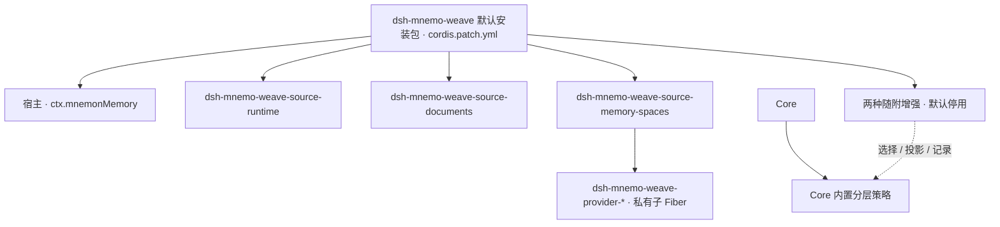
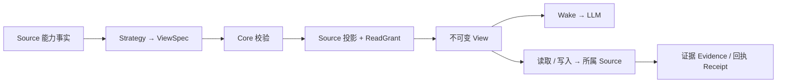
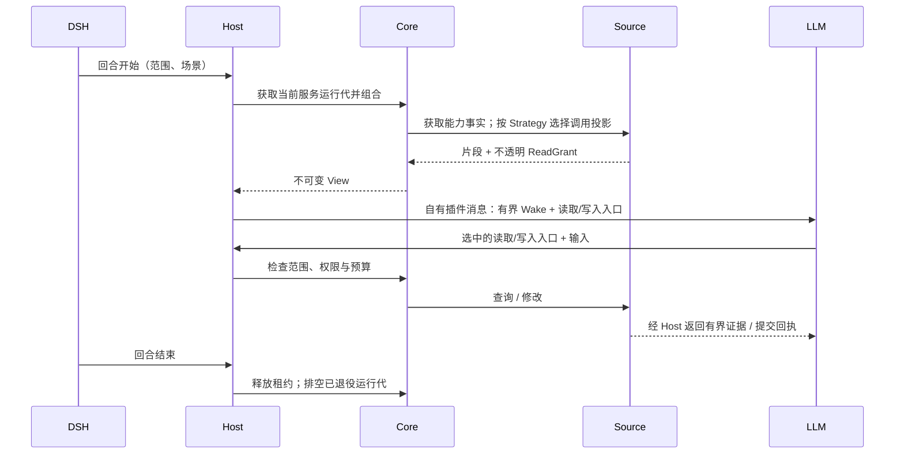

# 架构与契约

Codex 和 ZCode 各自启动一个 stdio MCP 进程。MCP 和 DSH 通过 `MNEMON_DATA_DIR` 下的 `working-rules/` 共享本机工作准则，未设置时使用 `~/.mnemon`。MCP 的 `--data-dir` 用于指定旧数据的迁入目录。

## 入口与依赖

入口负责读取配置、选择实现并连接宿主。库通过显式参数接收所需依赖。同步服务端和客户端各自实现一侧，通过共享协议和 HTTP 交互。

| 组件 | 代码 | 职责 |
|---|---|---|
| HTTP 同步服务入口 | [src/sync-server.ts](../src/sync-server.ts) | 读取进程配置，装配 HTTP 和 SQLite，管理监听和退出 |
| HTTP 同步服务库 | [HTTP 请求处理](../src/sync/server/http.ts)、[存储接口](../src/sync/server/store.ts)、[SQLite 实现](../src/sync/server/sqlite.ts) | 校验请求、推进游标、存储变更和数据块 |
| 同步协议 | [src/sync/protocol.ts](../src/sync/protocol.ts) | 定义双方共用的消息格式和校验规则 |
| 同步客户端库 | [src/sync/client/](../src/sync/client/) | 通过远端接口协调快照同步，提供 HTTP 实现和本地同步状态文件适配 |
| MCP 与 DSH 共用的工作准则 | [src/memory/working-rules.ts](../src/memory/working-rules.ts) | 装配本机 Runtime Memory 和工作准则快照适配 |
| MCP 入口 | [src/mcp.ts](../src/mcp.ts) | 解析启动参数，装配工作准则，注册工具并连接 stdio |
| Runtime Memory | [controller.ts](../src/components/source-runtime/src/controller.ts) | 读取条目、校验容量、持久化和跨进程写锁 |
| DSH 插件入口 | [src/index.ts](../src/index.ts)、[插件装配](../src/host/boot/plugin.ts) | 注册生命周期、工具和 RPC，接入工作区运行时；同步 RPC 提供工作准则和工作区 Pack 快照 |

HTTP 请求处理接收存储接口，由独立进程入口注入 SQLite。客户端快照协调接收远端接口和本地副本接口，由 MCP 与 DSH 接入各自的数据源。

## 数据边界

`runtime/memories.json` 保存条目，`runtime/MEMORY.md` 是记忆投影。MCP 读取本机工作准则中 `memory` 类型且未绑定 Git 分支的条目，追加操作也写入这一范围。DSH 的工作区记忆按宿主选择的存储范围落盘。宿主可在调用工具前对读写权限进行配置。

## 工具契约

| 工具 | 输入 | 返回 |
|---|---|---|
| `read_workspace_memory` | 空 | JSON 字符串数组，元素为记忆正文 |
| `append_workspace_memory` | `content`，去除首尾空白后非空，最多 8 KiB（UTF-8） | Runtime Memory 写入回执，包含条目数与容量用量 |

工具以 MCP 文本内容承载 JSON。写入受上游 Runtime Memory 的容量限制。

## 同步服务协议

Linux 服务入口为 `dist/mnemo-weave-sync-server.js`，运行需要 Node.js 24。它默认监听 `127.0.0.1:4319`，端口可用 `MNEMOWEAVE_SYNC_PORT` 修改。跨机器访问通过 HTTPS 反向代理，客户端仅对本机回环地址允许明文 HTTP。[部署与升级](dsh-operations.md#ops-服务器同步)

客户端向 `POST /v1/auth/login/challenge` 发送 SRP-6a 临时公钥，从服务端取得挑战 ID、盐和临时公钥。客户端通过 `POST /v1/auth/login/verify` 提交证明，再验证服务端返回的证明。验证通过后，客户端使用本次签发的 Bearer 令牌请求同步接口。挑战一次有效，60 秒过期；会话令牌有效期为 30 分钟，服务重启后失效。服务端持久化的认证记录只包含版本、盐和验证值，运行中的令牌以 SHA-256 摘要保存在内存中。工作准则和工作区数据经 HTTPS 传输，服务端保存其原始内容。

服务按存储范围维护 SQLite 变更日志。客户端通过 `GET /v1/sync/<scope>/changes?cursor=N` 分页读取，处理完一页后才能采用该页游标。`POST` 提交带请求 ID 和基准游标的批次。服务以事务追加整个批次，重复提交同一批次返回原游标。基准过期时返回 HTTP 409 和当前游标，客户端应先读入变化，再处理冲突。删除作为日志事件保留，落后的客户端重放时也能看到删除。


一个范围的内容按文件同步。每个文件以自身 SHA-256 为标识，通过同一范围下的 `/v1/sync/<scope>/blobs/<digest>` 上传和读取。客户端上传所有变化的文件后，以一个变更批次发布清单：清单列出这次快照包含哪些文件、各自的摘要，以及按固定顺序和固定时间戳组装后的归档摘要。

接收方按清单比对，只请求内容不同的文件，其余复用本机已有内容，在本地重新组装归档并校验总摘要，然后在现有 Source 写锁内确认本机内容仍与预检一致，再替换数据。归档是确定性构建的，所以部分下载能补齐成完整快照，总摘要也能端到端校验。服务端只保留最新清单引用的文件，被替换下来的文件在宽限期后删除。两边都改动时暂停同步，保留两份内容，等待明确选择。

MCP 从环境读取 `MNEMOWEAVE_SYNC_URL` 和 `MNEMOWEAVE_SYNC_PASSWORD`，已配置时在读写工作准则的入口同步。DSH 的 `sync-all` 从宿主凭据库或环境读取连接，对共享工作准则、全局或工作区 Pack、工作准则活动和工作区活动分别推进已有游标。工作区按 DSH 登记名称匹配，各个范围共用一次 PAKE 会话。

记忆读写和子 Agent 的结构化活动通过独立范围追加同步。DSH 保留接收旧客户端三类同步请求的 RPC。 [记忆活动记录与同步](memory-activity.md)

## DSH 组件边界

| 代码 | 职责 |
|---|---|
| [src/core](../src/core/) | 编译 Memory View，管理代际、回合和权限 |
| [src/sdk](../src/sdk/) | 提供 Source、Strategy 和扩展的公开接口 |
| [src/host](../src/host/) | 装配 DSH 生命周期、工具、设置、存储范围与任务 Agent；内部按 `contracts`、`configuration`、`boot`、`engine`、`session`、`delegation`、`skills`、`review`、`surface`、`support` 分包 |
| [src/client](../src/client/) | DSH WebUI、工作台和 Source 页面装配；内部按 `i18n`、`kit`、`connection`、`workspace`、`pages`、`panels`、`hosting`、`turn` 分包 |
| [src/components](../src/components/) | Source 持有存储与能力，Strategy 按回合选择和组合能力，Provider 由记忆空间 Source 管理 |

`src/host/contracts` 与 `src/client` 的分包名是目录约定，不是发布边界：对外仍只有 `dsh-mnemo-weave` 一个包，内部继续按组件开发和测试。WebUI 的样式表留在 `src/client` 根目录，因为 CSS 模块的类名哈希由文件路径决定，移动文件会改变已核对的类名。详见[仓库归属](development.md#verification-仓库归属)。

DSH 通过 bundle 组合这些组件，单个回合使用固定的 View；写入仍由相应 Source 执行并返回回执。记忆子任务使用 DSH 托管 activation，发布子 Agent 时注册任务指令和工具限制。Codex 和 ZCode 的 MCP 工具直接复用 Runtime Memory，当前范围是显式读取和追加未绑定分支的工作区条目。

根包构建产物在 `dist/`，其中 `mnemo-weave-mcp.js` 是 MCP 入口，`index.js`、`bundle.js`、`client.js` 是 DSH 入口。独立组件各自产出 `dist/`。

<a id="design-composable-view-memory-架构"></a>

<a id="design-可组合视图记忆架构"></a>

## 可组合视图记忆架构


可组合视图记忆（Composable View Memory）只有三个主要业务概念：**Source（记忆来源）** 拥有记忆及其操作；**Strategy（组合策略）** 提议可用 Source 如何参与；**View（上下文视图）** 是特定范围和场景下交给 LLM 的有界上下文与交互形态。运行时、档案、记忆空间是默认组合，不是 Core 对所有记忆的固定分类。

<a id="design-归属与装配"></a>

### 归属与装配



图中实线表示 Starter 安装归属，虚线表示用户开启后才生效的策略贡献，不是业务调用链。DSH 创建顶层 Entry/Fiber；Source、Strategy 与策略贡献使用同一套 `installMemory(ctx, ...)` SDK 注册，由 Cordis 负责卸载。Core 只提供 `ctx.mnemonMemory`，不替 Memory Spaces 实现 Fiber，也不提供 `ctx.mnemonMemorySpace`。

Memory Spaces **自己定义内部 Fiber 与 Provider 协议**。每个 Provider 都来自明确安装并配置的子模块；两个 Source 实例可以使用同名子节点，各自持有独立目录和凭据。不存在扫描依赖自动选择实现、全局 Provider 注册表等隐式装配。

借鉴 Spring Boot Starter，默认发行包负责选依赖、给默认配置，不把 Source 业务收回 Core。用户只安装 `dsh-mnemo-weave` 一个包；它内部的每个组件是 `src/components/<id>` 下的独立模块，可独立开发与测试，经 `dsh-mnemo-weave/<id>` 子路径发布为独立 Entry。Starter 安装全部官方组件，随附组件在记忆系统的「记忆组合」中管理，其中策略增强以停用 Entry 随附：增强在开关打开后参与 View。主策略不是插件，由 Core 内置，没有可选项。

| 归属 | 负责 | 不负责 |
|---|---|---|
| Core | 内部注册、协议校验、不可变 View、预算、运行代与租约 | Provider 驱动、Source 数据格式与存储决策、页面、DSH 生命周期策略 |
| SDK | 小型贡献服务、Source/Strategy 作者契约、安装辅助与限定范围的测试工具 | 引擎/注册表构造器、已安装记录、运行代句柄 |
| Source | 数据权威、facts、投影、grant、查询/修改、可选管理协议与 Client | 其他 Source 的控制器、全局策略选择 |
| Strategy | 确定性的纯函数 `request + facts + 自有槽贡献 → ViewSpec`，拥有槽语义 | 原始数据、凭据、驱动、副作用、扩张权限 |
| Host | scope、阶段 hook、工具/RPC、认证、设置、监督任务 | Source 私有实现与注册表 |
| Starter | 包集合、Entry id、默认配置 | 第二套加载器或运行时 |

`ctx.mnemonMemory` 是真正受限的服务对象，不是给引擎套一个更窄的 TypeScript 类型。它只暴露一个注册原语，由 `installMemory` 使用；Host 执行能力留在内部。Provider 在自己的 Source 内遵循同样原则，只收到绑定子节点的 `host.install` 能力。公开测试夹具验证这些协议，不交出私有宿主对象。

<a id="design-内置存储范围"></a>

### 内置存储范围

存储布局属于根包的 Host 基础设施。同一解析器处理 `global`、`workspace`、`custom` 与 `workspaces`；Core 传递选定的操作范围并执行 View 权限约束。文件系统路径归一化、环境变量与用户目录默认值、工作区目录哈希留在 Host，不新增存储贡献 API 或独立发布包。

Host 将解析后的目录交给各默认 Source。Source 继续拥有自己的格式、事务和 Provider 状态；切换布局不搬迁其数据。显式选择全局 USER.md 时仅用户档案使用全局根，项目数据仍留在所选工作区根。设置和只读清单使用同一布局解析器。

Host 复制或统计 Source 的文件时（Mnemon Pack、服务器同步和状态页的存储清单），从该 Source 的 `./contracts` 读取其文件名、锁文件与解析器：

- Runtime：目录、文件与锁文件，以及其控制器写入 USER.md/MEMORY.md 所用的投影与字节计数；
- Documents：目录、索引解析器与锁文件；
- Memory Spaces：存储布局、注册表解析器与记忆空间计数。比较与合并同一 Mnemon 存储的两个副本（[#370](https://github.com/omdsh-dev/dsh-mnemon/issues/370)、[#391](https://github.com/omdsh-dev/dsh-mnemon/issues/391)）由其仅限 Node 的 `./space-identity` 入口提供。

只有 Pack 对传入文件的自身检查留在 Host：memories.json 的条目、档案的 front matter 与内容哈希，以及存储的 SQLite 文件头。Pack 用各 Source 的名称拼出条目路径，条目集合固定为版本 1 格式。

<a id="design-默认插件组合"></a>

### 默认插件组合

| 插件 | 记忆权威 | 默认 View 贡献 |
|---|---|---|
| `dsh-mnemo-weave-source-runtime` | Runtime JSON、USER/MEMORY 投影、分支过滤与容量 | eager 精确工作上下文 |
| `dsh-mnemo-weave-source-documents` | 受管 Markdown、索引、搜索、修订与归档 | 有界叙事封面与搜索 route |
| `dsh-mnemo-weave-source-memory-spaces` | 记忆空间目录、内部 Provider、能力与召回质量策略 | 有界持久证据封面与 recall/related route |
| `dsh-mnemo-weave-source-skills` | 以文件哈希为界的 DSH 技能文件夹；版本、进化账本、评测集、记录的对话与市场来源 | 无：只用于管理；技能经由 DSH 自带的 `skill` 工具进入模型 |

唯一的 Provider 插件包是 `dsh-mnemo-weave-provider-mnemon-native`。Provider 运行在 Memory Spaces **内部**，负责存储/检索驱动，不是 Core 的新贡献种类。Git、Notion、健康记录通常应实现 Source；不同的组合方式应实现 Strategy。

分层策略对同一默认角色出现多个实例时报歧义错误，不按加载顺序猜测。`selection`、`projection` 与 `capture` 三个扩展槽是标准槽，由内置分层策略声明，因此增强可以直接使用。Core 只传递有界贡献并执行原有预算/权限校验，不理解这些槽的业务语义。

<a id="design-view-数据流"></a>

### View 数据流



View 包含投影片段、route、action offer 与仅留在 Host 的 ReadGrant。Wake 只渲染有界模型表示，并列出当前回合可用的具名工具；不泄露 grant 载荷、控制器或凭据。Evidence 记录来源与一致性，不是另一份持久记忆。

默认三层且未启用策略增强时，Core 按固定角色直接分配投影和操作预算。启用增强时，Core 先校验组合提案的实例、能力、操作和预算。两条路径都从宿主允许的 Source 能力中选择，绑定读取范围，执行写入时再次检查当前权限。一致性明确区分：捕获内容的 `exact-snapshot`，以及只能固定命名空间、远端内容仍可变化的 `namespace-pinned-live-read`。后者不冒充历史数据库快照。



<a id="design-生命周期与失败"></a>

### 生命周期与失败

Host 的 `MemoryExecutions` 统一持有 Core 回合及对应的运行时绑定。Agent 生命周期与后台协调器使用同一份所有权：并发维护共享一个 View，新回合等待子任务及工具清理完成后，再选择当前运行时。是否中止闲置整理仍由生命周期决定；执行所有者不会中止无关的已授权写入，也不会增加权限。

候选组合先验证，再发布。额外候选被拒绝时，不会悄悄替换 Serving 运行代；显式移除当前依赖的贡献时，该运行代退役，不再接新回合。已开始的回合和操作持有租约，结束后再排空旧 Source 及其私有资源。

每回合固定一个不可变 View。写入生成回执，后续回合读取新修订；并发父/子 Agent 不能借用另一回合的 grant。Source/Provider 故障保持局部、可观察；部分成功、失败、取消、已提交不会混为一谈。停用参与不删除数据。

提示词组装会提前准备 View，以注入可信的 Strategy 指令。Agent 接受执行步骤时也会确保自己的持久回合已有 View，避免提示词拦截器或稍晚注册的生命周期留下没有回合绑定的记忆工具。Wake 交付记忆投影和可用的具名工具。子 Agent 在每回合首个被接受的步骤收到其捕获 View 的 Wake，无论组装阶段已准备好绑定，还是执行步骤恢复了绑定；后续步骤不会重复追加。Runtime 正文继承默认关闭（`runtimeMemory.inheritToSubagents`）。子 Agent 在派发时捕获该偏好；关闭时仅在展示层过滤所有 Runtime Source 投影，保留其他来源、Route/Action 权限及明确的任务输入。模型正文检查使用相同过滤，开启时保留捕获的 Runtime 快照和既有请求前缀。拒绝或取消的步骤释放绑定，本回合不可用的组合仍要等到下一回合才会重新尝试。

子 Agent 在派发时捕获委托 View 及运行代，保留至自身释放，不因父回合结束或 Serving 换代而改变。每次子执行具有独立回合身份与检索预算，不会回退到父 Agent 的最新 View。Wake 以 `dsh-mnemo-weave` 自有插件消息追加在共享上下文之后，不重复注入或插值其他插件的上下文。

<a id="design-webui-与管理面"></a>

### WebUI 与管理面

默认 Source 在自己的 `presentation/` 中持有双语文案与布局资源，并由自己的 Client 加载；Starter 也通过公开包路径组合这些资源，保留既有可选页面工具的导出。工作台负责导航、容器和主题，不再掌握 Source 专属选择器。这是默认产品的呈现组合，不是 Core 要求或新的 UI 框架。

Source 自己拥有可选的 `./client` DSH 模块、页面、管理协议与测试，通过公开 Source 页面 SDK 注册到工作台的 `mnemon.source.page` Slot。Client 生命周期与 React 渲染仍由 DSH 管理。

组件自己的设置在它的组件页上遵循同样的原则：组件页由 DSH 为它列出的行提供，从记忆系统的**设置**页打开时就地显示；组件从自己的 `./client` 注册到 `mnemon.component.settings` 区域，记忆空间的 Provider 与嵌入就是这样提供的。这些设置需要 dsh-mnemo-weave 的配置或 Host 操作时，页面借给注册在该组件键下的设置一个限定范围的 `host`，而不是设置服务或传输层。dsh-mnemo-weave 还把记忆空间的设置保留为后备：只要记忆空间自己的客户端没有注册设置（记忆空间关闭时、其客户端加载期间、客户端出错时，以及搭配本身没有设置的旧版本时），页面就由后备绘制，记忆空间自己的注册会替代它；详见[扩展开发](extensions.md#extensions-组件自己的设置与状态卡片)。

Host 交给页面的是限定实例的管理客户端与脱敏元信息，不是裸 RPC、Host Context 或 LLM grant。读取和带确认、修订栅栏的修改指向一个 Source。档案归档到记忆空间等默认协作由 Host 编排，也只调用公开管理协议。技能进化同样如此：Host 记录每个回合的步骤、为窗口计分、在下一次停顿时安排复盘，并以任务 Agent 运行复盘、草案与回测，每个结果都通过技能管理 Source 带修订栅栏的操作写入；Source 本身从不调用模型。它的设置是实时生效的 `mnemon-skills` 范围，修改直接作用于运行中的进化与客户端，不重建运行图。

同一个共用工作台提供两个互斥的 DSH 入口。Sidebar 在[受支持的 DSH](usage.md) 公开的 `sidebar.panellist` 与 `main` Slot 中注册配对的 `mnemon` 入口。DSH 负责按钮、图标尺寸、标签、选中状态和主面板导航。`shell.overlay` 注册保留 Source 子 Slot 的渲染权限，将工作台 portal 到持久的原生主面板挂载点，从而保留切换面板时的页面状态和独立的 Better Sidebar 挂载点。未提供原生面板契约的替换布局继续使用现有入口及浮层回退。Sidebar 无会话也可打开，保留自己的工作区选择，与 Taskboard/SSH 协调，并通过 `layout.selectPanel(null)` 返回会话。会话标签页（`builtin`）使用 `conversation.view`，读写和任务均使用所属会话的存储范围，不提供独立工作区选择器。两个入口渲染同一组 Source 自有子 Slot，不创建第二个 React root、兜底页面注册表或复制业务页面。

<a id="design-安全边界"></a>

### 安全边界

以下是 Host 在进程、文件、WebUI 与任务 Agent 周围保持的边界。它们不是秘密扫描器：这对你保存的数据意味着什么，见[运维指南](dsh-operations.md#ops-安全边界)；如何报告漏洞，见 [SECURITY.md](../SECURITY.md)。

<a id="design-进程"></a>

#### 进程

- CLI 使用 `spawn(command, args, { shell: false })`，不拼接 shell。
- 每次调用的 stdout + stderr 合计限制 2 MiB。Mnemon Native 在内容列表、图谱，以及运行时记忆归档前的逐字比对中会读取整个记忆空间，这些读取随 Store 增长，上限为 128 MiB。
- 调用失败时会写明原因：只有启动失败才提示安装 Mnemon 或设置 `mnemon.cliPath`；超时、取消和输出超出上限会各自说明。
- 每次调用受 `timeoutMs` 与 AbortSignal 控制；取消先 `SIGTERM`，1.5 秒后 `SIGKILL`。
- 单个 Runner 内调用串行；跨 DSH 进程仍依赖 Mnemon / SQLite 并发语义。

<a id="design-文件"></a>

#### 文件

- Runtime、Documents 和 Pack 操作使用进程内队列或组件锁。
- lock 默认等待 5 秒，超过 30 秒才视为 stale。
- 写入使用临时文件、staging 与 rename。
- Runtime revision 阻止过期压缩覆盖；Document revision 阻止移动已更新原文。
- `sourcePaths` 不能逃出发起会话工作区，也不能指向受管 Documents 目录。

<a id="design-web-与模型"></a>

#### Web 与模型

- DSH 负责远程 RPC 与 stream 的认证或配对；Mnemon 的 API Gateway 映射对管理操作另行要求 `remoteAccess: trusted-host`，本地回环客户端与 DSH 桌面版窗口（`dsh-app://app/`）使用各自的通道。
- Provider 目录和管理响应始终脱敏；界面只显示已配置字段名，不返回已保存凭据值。
- WebUI 依据 Host 返回的可写 settings snapshot 判断产品能力，不再根据传输位置猜测权限；设置通道不可用时会显示明确诊断，而不是空白页。
- WebUI 不直接读取 SQLite、启动进程、调用远程 Provider 或指定任意更新命令；Provider 网络访问只发生在 Host。
- worker 使用 persona、工具白名单与 `maxDepth: 1`。固定结果工具仅接受当前子任务的可撤销请求 ID，并按每次操作的 schema 校验结果。
- 蒸馏和 supervised writeback worker 不能调用 `mnemo_forget`；空闲审查的档案写入只开放仅创建工具，不能覆盖用户原文，也不能通过归档腾出容量。这些限制默认启用，无需增强插件。
- 空闲审查每轮只写一层：建了工作区档案后，修改工作记忆会被拒绝；修改工作记忆后，新建工作区档案会被拒绝。`idleReview.runtimeMemory: false` 会完全收回它的运行时记忆工具。
- 查询、候选、档案正文与历史记忆全部按不可信数据处理。

<a id="design-使用兼容与未来演进"></a>

### 使用兼容与未来演进

默认 Starter 保留存储选择、持久格式、具名工具及使用流程。`displayMode` 选择默认的 `sidebar` 或 `builtin`；Host 接受旧 `buildin`，并在配置可写时通过 DSH 带修订栅栏的设置写入器保存规范拼写。这只修改一项偏好，不改变记忆数据或 Core/Source 契约；其他配置键保留原有语义。这**不意味着**保留私有控制器、旧根包 `kernel/layers/provider-sdk` 入口和历史包装包。当前公开入口见[扩展开发](extensions.md)。

RSI 的边界保持简洁：产出候选 Source/Strategy 制品，用固定 facts/request 测试与回放，审查权限，再按正常装配方式安装和选择。运行代支持验证后的替换与排空，不是自动执行生成代码或自动晋升服务。Cordis 的归属/隔离并非安全沙箱；高风险外部操作仍需单独的授权边界，不能以“记忆”之名自动获得权限。

<a id="storage-存储与记忆模型"></a>

## 存储与记忆模型


<a id="storage-为什么分三类记忆"></a>

### 为什么分三类记忆

默认 Starter 用三个独立 Source 处理不同的访问模式，再由分层策略把它们组合进每一轮。这是默认组合，不是 Core 的固定分类，也不限制第三方 Source 的形态：

| 问题 | 存放位置 | 原因 |
|---|---|---|
| 下一轮必须直接知道什么？ | Runtime Memory | 极小、直接进入 prompt |
| 哪份设计或流程需要快速完整阅读？ | active Documents | 保留 Markdown 结构，不必做深召回 |
| 哪些历史事实和关系应跨会话存在？ | Memory Spaces | 独立数据库、图关系、按需召回 |
| 长文已不常用但仍需追溯怎么办？ | archived Documents | Mnemon 留索引，冷层保留原文 |

推荐查询梯度：

```text
current request and repository facts
             |
             v
Runtime Memory already in prompt
             |
             v
search active Documents
             |
             v
recall active Memory Spaces
             |
             v
follow an exact cold reference when full text is required
```

<a id="storage-工作区参与范围"></a>

### 工作区参与范围

存储范围决定数据保存在哪里；[`excludedWorkspaces`](dsh-configuration.md#按工作区排除记忆) 决定哪些工作区会话参与 Mnemon。排除列表默认为空，对所有存储范围生效，子代理即使改变 cwd 也继承父会话的决策。已有数据和会话历史保持完整。工作台标明排除状态并允许查看；移除排除项后恢复记忆参与。

<a id="storage-跨-agent-共享边界"></a>

### 跨 Agent 共享边界

共享不意味着广播对话或文件。多个 Agent 都集成 Mnemon，且能够访问相同存储根与可识别的 Store 时，可以共享 Native 长期事实。三方 Provider 通过自己的 workspace、user、bank、project 或 container 范围共享；Runtime 与 Documents 不会自动进入其他 Agent 的上下文。

哪种共享适合哪个范围，见[选择跨 Agent 共享范围](dsh-configuration.md#选择跨-agent-共享范围)。多进程并发依赖 Provider 自身的一致性保证；离线复制或直接修改本地数据库前，应停止所有使用者，参见[运维指南](dsh-operations.md#ops-备份与恢复)。

<a id="storage-统一根目录"></a>

### 统一根目录

```text
<storageRoot>/
+-- runtime/
|   +-- memories.json
|   +-- USER.md
|   +-- MEMORY.md
|   +-- archived/                  # 本地归档，仅在没有记忆空间能接收归档时出现
|       +-- MEMORY.md
|       +-- memories.jsonl
+-- documents/
|   +-- index.json
|   +-- active/
|   +-- archived/
+-- skills/                        # 技能管理；不进入 Mnemon Pack
|   +-- ledger.json
|   +-- evals.json
|   +-- trajectories/
|   +-- versions/
|   +-- market/
|   +-- trash/
+-- data/
|   +-- .dsh-memory-bodies.json
|   +-- <memory-space-id>/
|       +-- mnemon.db
+-- state/
    +-- machine.json              # 本机标识与名称，0600，不进入 Mnemon Pack
    +-- review-ledger.json        # 待决策的整理建议，0600，不进入 Mnemon Pack
    +-- idle-review/              # 显式启用的本机会话审查配额（尝试次数与冷却时间）；不进入 Pack 或同步
    +-- memory-providers.json     # 第三方连接控制面，0600，不进入 Mnemon Pack
    +-- server-sync-<hash>.json   # 本机同步游标；不进入 Mnemon Pack
```

`storageScope` 选择的是整个根，而不只是 Mnemon 数据库；每个范围解析到哪个根，见[存储范围](dsh-configuration.md#存储范围)。显式启用的 `runtimeUserScope=global` 是唯一的分根例外：Runtime 从全局根读取 USER.md，MEMORY.md 与其他所有组件仍留在所选根。工作台任务使用查看工作区；对话工具与生命周期使用所属会话的 cwd 和已固定的 View。Host 解析目录时不创建文件，也不修改旧根。

`state/` 下的文件：

- `memory-providers.json` 保存第三方 endpoint、目标 URI、身份和可选凭据；文件权限为 `0600`，Host 只返回已配置字段名，不回传凭据值。
- `machine.json` 记录每个导出包都会带上的本机标识：生成的 id、默认取自主机名（用户改名后则为新名字）的标签，以及创建时间。
- `review-ledger.json` 保存整理建议与留在其上的意见，最新在前，上限 200 条。

`machine.json` 与 `review-ledger.json` 都不属于任何 Pack 组件，因此都不会同步：机器的身份与审查历史留在产生它的机器上。

<a id="storage-runtime-memory"></a>


`state/idle-review/<sha256(parentSessionId)>.json` 是独立的 Host 版本 1 文件，包含原始会话 ID、安全整数 `attempts` 与 `lastReviewAttemptAt`（毫秒，空状态为 `null`）。根目录来自实际服务父会话的运行时图，与 Source/View 选择和全局 USER.md 选项无关。文件不存在时从空状态开始；JSON 损坏、未知版本、ID/数字非法、超过 16 KiB 或非 ENOENT 读写失败会暂停自动审查。支持的平台上新文件使用 `0600`，目录使用 `0700`。

预约在短暂的同步读取/检查/原子替换临界区中完成，并以每会话独占的 `<hash>.json.lock` 目录保护。共享本机根目录的独立 Host 不会同时重复预约额度；锁冲突立即暂停竞争失败一方的自动审查。不会自动抢占锁。崩溃可能已消耗预约，或遗留废弃锁；修复状态/删除废弃锁前必须停止所有相关 Host，然后重新打开会话。此保证基于本机文件系统；网络文件系统必须提供等效的独占建目录与原子替换语义。替换失败保留旧文件。配额记录和临时文件不进入 Pack 或 服务器同步，不含对话内容或完成重放记录，不自动清理。关闭设置或回滚不会删除文件；手动删除会话文件会重置额度。

<a id="storage-运行时记忆"></a>

### 运行时记忆

内置 DSH Source 与 Codex、ZCode 现在共用本机的「工作准则」。正式数据位于全局根下的 `working-rules/runtime/memories.json`，同目录下的 `工作准则.md` 是供人阅读的唯一当前投影。读取和写入沿用 Runtime Controller 与跨进程写锁。现有 USER/MEMORY 条目按旧存储根一次性导入，包括重要性、时间、置顶和适用分支。旧工作区在新版识别到其存储路径时迁入。

合并后的容量初始值取现有两项配置之和，默认 14 KiB。导入完整保留已有条目。后续写入超限时，优先保留置顶及高重要性条目，移出的条目归档到共享目录的 `runtime/archived/`。工作准则位于独立的本机目录，并以独立的同步范围参与服务器同步；工作区 Pack 仍作用于各自数据根。

下方双目标契约用于旧数据和独立 Runtime Source。内置工作准则页面及模型工具按一份集合读写。

<a id="storage-语义"></a>

#### 语义

- `target=user`：身份、角色、长期偏好、习惯、沟通风格和明确协作要求。
- `target=memory`：项目、环境、决策、约定、工具特性和可复用经验。
- `importance=critical|normal|low`：记录的重要性，在模型投影中可见，也用于整理时的保留优先级。
- `branches`（可选，仅 `target=memory`）：限定该条目在每回合 Runtime 快照中投影到的 git 分支名列表；没有分支列表的条目在所有分支可见。

当前不实现 `daily` target。

<a id="storage-事实源和投影"></a>

#### 事实源和投影

在单个根内，`runtime/memories.json` 是唯一事实源。启用 `runtimeUserScope=global` 后，有效快照只组合全局事实源中的 `target=user` 条目与所选事实源中的 `target=memory` 条目。两个 JSON 文件和两组 Markdown 投影始终保持完整且不改写；过滤只发生在有效 Runtime controller。每条记录包含：

```text
content
created_at
updated_at
target
importance
branches（可选）
pinned（可选）
```

`branches` 是 `target=memory` 条目的可选 git 分支名列表。没有 `branches`（或为空列表）的条目在所有分支可见。当会话的 workspace 是位于分支 `B` 的 git 工作树时，每回合的 Runtime 快照会隐藏 `branches` 列表不包含 `B` 的 `memory` 条目；非 git 工作区和 detached HEAD 下所有条目都会投影。`USER.md` 条目永远不携带 `branches`。

`USER.md` 和 `MEMORY.md` 是完整事实源的确定性派生文件。每个条目被归一成单行，条目之间使用单独一行的 `§` 分隔；`§` 是保留字符。启动和 prompt 组装时，控制层会从 JSON 修复缺失或被手工修改的投影。分支过滤只作用于 prompt 投影，不作用于这两个文件。

Runtime Source 在面向模型的快照中，只为含非默认注释的条目添加元数据行：

```text
[importance=critical; created=14d; updated=2d]
偏好简洁回复。
```

`created` 和 `updated` 表示距存储时间戳经过的完整 24 小时天数，在捕获投影时统一计算。不到一天默认为 `0d` 并省略，`importance=normal` 也省略；没有剩余注释时，不生成元数据行。未来时间戳仍显示 `future`，无法解析的时间戳仍显示 `unknown`。用户档案位于全局根时，两个根使用同一个捕获时间。当前回合保持已捕获的天数；下一回合会重新计算，即使存储 revision 没有变化。

面向模型的文本省略 revision 哈希、条目计数和存储配额统计；版本校验仍由 Source 协议承担，管理接口与 UI 保留监控信息。文件边界和所有可见条目（包括低重要性条目）均保留。本次格式调整不做内容分类或延迟召回。

这些行是正文之外的注释。`old_text` / `oldText` 只能匹配正文，不包含元数据行。记录的重要性和时间跨度不会覆盖当前指令。JSON、磁盘 Markdown、正文匹配、条目顺序和存储容量均保持不变。注释计入已有的模型投影字符预算，因此短条目较多时，即使默认 Strategy 也可能截断或省略条目。其指引明确说明快照受预算限制，缺失不代表删除；投影上限配置可以进一步降低预算。

会话的模型输入保留一组有界的完整 Mnemon View 快照，仍是 user 角色的引用数据。在相同授权范围内，内容未变化就复用已有快照，重新打开会话后也一样。Runtime 新增和年龄注释变化只追加，不改写此前的请求前缀；如果再添加一份将超过四份快照或 64 KiB UTF-8 文本，就将旧组替换为当前完整快照。当前单份即使超过 64 KiB，也仍然单独完整保留。这些阈值是初始工程默认值，不是实测最优缓存配置；它不会降低 View 的投影预算或缩短当前输出。

Runtime 事实删除或修正，以及权限、Source、工作区、分支或不透明 ReadGrant 变化，会在下一次适用模型请求前触发 checkpoint，即使渲染文本完全相同。Runtime 通过 Source 自有 provenance 提供范围与可见条目摘要；未知或已截断投影按全文保守比较。最新快照代表当前投影状态，缺失仍可能来自过滤或投影预算，不代表存储中已删除。原始快照与替换来源关系保留在 DSH 追加式审计日志中。升级清理只识别本生产者包含完整内置 Runtime 快照信封的旧 `recall` 消息，或带已知固定结构和 SDK 省略号的官方截断；普通召回、指导、用户消息及其他生产者的消息保持原样。清理需要插件处于启用状态，并保留既有固定 View 与委派子 Agent 的租约契约。

<a id="storage-固定运行时条目"></a>

#### 固定运行时条目

在运行时页面使用**固定 / 取消固定**。这是人工显式设置，与重要性独立；旧记录缺少 `pinned` 时仍视为未固定。每个目标显示固定条目数和投影占用。预留预算为**每个目标 1,536 字符**，包含固定标签及重要性注解。超过预算的固定操作会直接拒绝，数据不变；取消固定仍可用于恢复导入或手工编辑后超额的集合。

当前可见的 USER 和 MEMORY 固定条目都排在普通条目前。内置分层策略会在现有 View 上限内为其完整正文预留空间，包括限定范围配置。上限无法容纳固定集合时，组合明确报错，提示取消固定或提高 View 预算。自定义策略需处理 Source 的 `hints.minimumProjectionCharacters`（可使用公开 SDK 的 `reserveMemoryProjection`）；Runtime 会拒绝截断固定内容。显式禁用/排除的来源、分支过滤，以及未开启 Runtime 继承的子 Agent，仍遵循原规则。固定保证已接纳投影中的内容出现，不保证模型服从，也不提升其相对当前指令的权限。

容量维护先保留固定原文，再按重要性装填其他条目；只有未固定的工作记忆会送往 Provider 或本地归档。USER 整理仅将未固定条目交给模型，Host 与 Source 逐字保留固定原文。固定集合与待写入内容无法同时放进硬容量上限时，在模型或 Provider 工作前拒绝操作。通常的 70% 整理目标属于软目标，须让位于固定内容。人工编辑正文保留固定标记，显式删除仍会删除条目。

Pack、同步合并、溢出装填和基于原始元数据的恢复保留可选布尔值。同正文冲突时，较新的显式固定/取消固定决定生效；没有字段的旧副本不能清除本地决定。所有参与写入/同步的安装均需升级到支持固定的版本：旧版本可能丢弃未知字段，不支持固定元数据的降级往返。新版 Source 遇到旧 Host SDK 时会拒绝开启固定或执行固定条目的容量维护，普通未固定用法仍可用。Markdown 仍是纯文本派生文件，不携带固定元数据。

<a id="storage-操作"></a>

#### 操作

- `add` 写入独立新事实，完全相同的内容不会重复添加。
- `replace` 和 `remove` 先在请求的 `target` 内，用规范化后的 `old_text` 匹配完整正文，再替换或移除整个条目。唯一的精确匹配优先，即使其他条目也包含同样的文本。
- 没有完整正文匹配时，仍可用唯一子串定位条目。
- 零命中、重复的精确匹配和有歧义的子串匹配均拒绝，不改动存储，也不执行模糊修改。分支标签控制投影，不用于选择 mutation 的目标条目。

<a id="storage-容量"></a>

#### 容量

| 目标 | 默认上限 | 维护方式 |
|---|---:|---|
| `USER.md` | 4 KiB | 本地、无工具 worker 保守合并，不进入 Memory Space |
| `MEMORY.md` | 10 KiB | Host 精确归档已提交条目，再确定性装填保留在运行时记忆中的余量；没有能接收它们的记忆空间时，未保留的条目移入 `runtime/archived/` |

两个上限都可以通过 `runtimeMemory.userLimitBytes` 与 `runtimeMemory.memoryLimitBytes` 调整，见 [Runtime Memory 容量与维护预算](dsh-configuration.md#runtime-memory-容量与维护预算)。分层策略下，合法写入超过上限时才触发容量维护；其他策略会直接拒绝该写入。具名工具、后台子 Agent 和 Web 管理共用同一 Host 流程；Web 写入按所选存储范围执行，不要求打开用户会话。归档失败会保留运行时记忆并返回错误。完全没有能接收归档的记忆空间时，Runtime Source 改为在同一把锁内、提交之前，把未保留的条目移入 `runtime/archived/`。底层 Source 独立使用时仍只执行自己的存储操作，自定义 Strategy 不会隐式继承默认归档。

容量按存储正文和条目分隔符的实际 UTF-8 字节计算，不包含仅用于 prompt 的元数据。单条内容最大 8 KiB。当 `add`、`replace` 或 `remove` 遇到容量溢出时，Host 会在任何 Provider 写入前重新检查源 revision。只有一个可写 Memory Space 时完全不调用模型；存在多个空间时，worker 只读取有界路由摘录并返回目标 id，不重写记忆内容。Mnemon Native 先从只读命名空间快照复用完全相同的原文，合并批内相同条目，再按目标空间通过 schema-v1 draft 和 `--no-diff` 各导入一次剩余原文，避免内容相似但不同的事实被跳过或相互覆盖。其他 Provider 继续使用适配器定义的写入语义。Host 要求每个源条目都有一条精确终态回执（跳过的重复项还必须有精确 Recall 证据），随后按重要性和字节预算选择运行时记忆的保留项，并在原 revision fence 下把余量与待处理变更一次提交。Provider 无法与本地文件共享同一事务，因此稍后的 revision 冲突或并发外部写入可能留下已经归档的重复项；现有的运行时记忆条目仍受修订检查保护。

<a id="storage-project-documents"></a>

<a id="storage-工作区档案"></a>

### 工作区档案

<a id="storage-用途"></a>

#### 用途

Documents 保存比单条记忆更完整、又希望快速阅读的项目知识，例如：

- 架构设计和理由；
- 有证据的调查结论；
- 操作流程、发布清单和故障复盘；
- 实现交接与长期维护说明。

用户画像、普通聊天、临时进度、原始大日志和秘密不应进入 Documents。

<a id="storage-控制面"></a>

#### 控制面

`documents/index.json` 是元数据事实源，管理 ID、标题、description、状态、文件名、所属工作区、来源路径、session、时间、revision、SHA-256、大小和 Memory Space 引用。Markdown 托管副本带有生成的 frontmatter。

`workspaceRoot` 记录写入这份档案时 Source 收到的 DSH 工作区，新写入的档案都带这一字段；旧版本写下的记录没有它，读取时视为“未记录工作区”。它是控制面的归属标记，不改变文件位置。

`sourcePaths`：

- 只能指向当前会话工作区内部；
- 只作为来源引用，不会被插件修改；
- 当前实现不要求路径实际存在；
- 不允许指向受管 `documents/` 目录自身。

<a id="storage-范围"></a>

#### 范围

Documents 的物理共享范围由 `storageScope` 决定：

- `workspace` / `workspaces`：通常随项目隔离；
- `global` / `custom`：多个工作区可能共享同一个 `documents/index.json`。

因此“工作区档案”表示内容类型，不保证天然按工作区物理隔离。当前会话工作区只约束新写入的 `sourcePaths`。

每份档案记录它写入时所属的工作区，`snapshot` 按这一字段汇总出 `workspaces`，档案页面据此提供工作区筛选：可以只看某个工作区，或只看未记录工作区的旧档案。筛选只影响页面；`mnemo_document_search` 与投影仍返回 View 固定范围内的全部档案。

<a id="storage-容量与冷热分层"></a>

#### 容量与冷热分层

| 项目 | 限制 |
|---|---:|
| 单份正文 | 最大 2 MiB |
| active 总量 | 最大 10 MiB，包含生成后的 frontmatter |
| archived 总量 | 不计 active 上限 |

创建或更新前会计算真实投影大小。空间不足时按 `lastAccessedAt`、再按 `updatedAt` 选择最久未访问的 active 文档；先写入/验证 Mnemon 冷引用，再在 revision 未变化时迁移原文。

默认搜索只覆盖 active。搜索会更新命中文档的 `lastAccessedAt`，因此它对正文只读，但会写索引元数据。

<a id="storage-memory-spaces"></a>

<a id="storage-记忆体"></a>

<a id="storage-记忆空间"></a>

### 记忆空间

记忆空间是长期记忆的统一语义与路由单位，具体数据面由 Provider 决定：

```text
id            Host 生成或沿用已发现的 Mnemon Store 名
name          人类可读名称
description   路由边界：什么属于这里、何时召回
active        是否参与 DSH 读取与路由
provider      mnemon-native 或已登记的三方引擎
location      本地 Store/CLI 作用域，或远程 endpoint + Provider 作用域
```

<a id="storage-读写边界"></a>

#### 读写边界

- Mnemon 原生层在初始化后至少保留一个 Store，并通过 `<storageRoot>/active` 选择一个默认 Store；普通 Mnemon Agent 仍按这套单 Store 语义工作。
- dsh-mnemo-weave 的激活状态是独立控制面：任意 0..N 个记忆空间可以激活，全部未激活也不会改变 Mnemon 默认 Store 或远程数据。
- 召回与浏览只使用已激活记忆空间；图谱、实体、关联、链接和删除由 Provider 能力决定。
- 指定未激活记忆空间进行读取会被拒绝。
- 写入可以选择任何支持 `remember` 的已登记记忆空间；回执会反映 Provider 的精确写入或异步提炼语义。
- 对未激活目标写入成功后，插件自动激活它。
- 没有显式目标且激活数量不是 1 时，确定性服务要求调用方先选择目标。

<a id="storage-创建发现和合并"></a>

#### 创建、发现和合并

- 未初始化的空根可以保持零 Store；第一次显式创建记忆空间时使用 Mnemon 原生 `default` ID，名称与路由说明仍由用户决定，后续创建使用 Host 生成的 UUID。
- 初始化后不能删除最后一个原生 Store，但可以将最后一个记忆空间设为未激活。删除 Mnemon 默认 Store 时，插件会先切换到另一个现存 Store。
- 既有 `<storageRoot>/data/<store>/mnemon.db` 会被发现并登记，不移动数据库。
- 合并通过 Mnemon import 把来源内容导入目标；来源数据库保留，默认只将来源设为未激活。
- Pack 替换不能把已初始化的 Store 集合清空；替换后若原默认 Store 已不存在，插件会选择一个现存 Store 修复原生默认指针。
- `forget` 是按精确 ID 的软删除，不等于删除数据库文件。
- 用户可在既有“创建记忆空间”弹窗选择 Mnemon Native 或任意已登记三方引擎，也可在智能模式中显式加入已配置候选；断开只删除本地连接登记，不删除 Provider 数据。
- 智能 placement 的允许列表、数据边界与必需能力是 Host 强制规则；软偏好与 Prompt 只用于多个合格候选之间的语义选择，不能绕过硬规则。决策回执与记忆空间元数据一起保存。
- 合并仍只适用于 Mnemon Native。图谱、关系、浏览、精确/异步写入以及硬/软/不支持删除都以各 Provider 声明能力为准；UI 与 Agent 不会假装补齐缺失行为。见 [Provider 能力矩阵](dsh-operations.md)。

<a id="storage-跨-agent-可见性"></a>

#### 跨 Agent 可见性

`mnemon.db` 是 Mnemon 原生数据面，不是 dsh-mnemo-weave 私有格式。其他 Mnemon-enabled Agent 在使用同一个 `storageRoot` 和 Store 时，可以访问同一份长期记忆。dsh-mnemo-weave 也会发现磁盘上兼容的 Store；其 DSH 专有名称、说明和激活状态仍由 `.dsh-memory-bodies.json` 管理。

三方可见性由各自 Provider 作用域决定，例如服务与 URI、workspace/peers、bank、project/user、知识目录或 container。任何 Provider 的共享都不延伸到 `runtime/` 或 `documents/`；不能把“共享第三层记忆”表述为自动共享完整 DSH 上下文。

<a id="storage-技能管理"></a>

### 技能管理

技能管理管理的是 DSH 本来就会读取的文件，它从不进入回合的 View。技能本身留在 DSH 的技能目录里——`<project>/.dsh/skills`、`<project>/.agents/skills`、`$DSH_HOME/skills`（`~/.dsh/skills`）和 `$DSH_AGENTS_HOME/skills`（`~/.agents/skills`）——每次写入都以文件的 SHA-256 为准。技能管理为它们保存的内容放在存储根目录的 `skills/` 文件夹中：

| 路径 | 内容 | 保留 |
|---|---|---|
| `ledger.json` | 建议、草案、复盘日志、记录对话的摘要、版本索引和市场安装记录 | 最近 200 条复盘、60 份草案 |
| `evals.json` | 测试用例与回测记录 | 每个技能 40 个用例、20 次回测 |
| `trajectories/<id>.json` | 一段记录下来的对话：编号步骤及复盘在其上的标注，机密已替换 | 最近 100 段；置顶的、被建议或用例引用的最后清理 |
| `versions/<skill>/<id>.md` | 每个旧版本的 `SKILL.md`，用于对比和恢复 | 每个技能 30 个 |
| `market/registries.json`、`market/cache/<id>.json` | 市场里添加的来源，以及每个来源最近一次发布的列表 | 直到移除；六小时后刷新 |
| `trash/` | 被删除、或被更新与恢复替换下来的技能文件夹 | 直到手动删除 |

该文件夹在存储锁内以原子替换方式写入，和其他 Source 一样跟随存储范围。它不属于 Mnemon Pack，因此 ZIP 备份和 服务器同步都不包含它；技能本身就是各技能目录里的普通文件。它的设置属于配置，保存在 `mnemon` 条目的 `skills` 下，见[技能管理设置](dsh-configuration.md#技能管理设置)。

改进建议和草案在版本 1 的 `ledger.json` 中新增可选 `origin`：技能文件的绝对 `path`，以及项目技能所属的 `workspace`。本地路径来自 Source 目录，不接受模型或浏览器传入的来源。旧项目记录在所引用的准确复盘轨迹能确定唯一工作区时恢复来源；无法确定时保留正文并显示恢复步骤。读取不会重写账本，也不移动技能文件。旧版本能读取新增字段，但不执行来源绑定，因此降级会恢复原来的跨工作区限制。人工管理继续要求确认和版本检查，这些元数据不授予模型 View 访问权。

<a id="storage-四类关系"></a>

### 四类关系

Mnemon Native 保留 `temporal`、`semantic`、`causal` 和 `entity` 关系。适配器不会伪造不存在的图谱边，记忆空间页会按能力隐藏不适用的关联、链接、浏览与遗忘动作。

<a id="storage-数据权威表"></a>

### 数据权威表

| 数据 | 权威源 | 派生/缓存 |
|---|---|---|
| 运行时记忆 | `runtime/memories.json` | `USER.md`、`MEMORY.md` |
| Documents | `documents/index.json` + 托管 Markdown | excerpt、搜索排序、状态聚合 |
| Mnemon Native 目录 | `data/.dsh-memory-bodies.json` + 磁盘 Store | Web 状态聚合 |
| 第三方 Provider 连接 | `state/memory-providers.json` | 脱敏的 Provider 能力与状态 |
| 机器标识 | `state/machine.json`：id、名称与 `labelSource`（`hostname` 跟随主机名，`custom` 为手动填写） | 导出包与同步状态中的 `machine` 字段 |
| 整理建议 | `state/review-ledger.json` | 审查卡片；被接受的建议作用于各 Source，而不是账本本身 |
| 技能 | DSH 技能目录中的 `SKILL.md` 文件夹 | 技能管理页面展示的目录；`skills/` 中的版本、安装记录与市场缓存 |
| 技能进化 | `skills/ledger.json`、`skills/evals.json`、`skills/trajectories/` | “进化”上的计数、状态卡片与回合下方的提示行 |
| 长期记忆 | Mnemon `mnemon.db` 或远程 Provider | 图谱投影、跨 Provider 排名融合 |
| 审查配额（尝试次数与冷却时间） | 默认在 Host 进程内存中；启用持久化时存入 `state/idle-review/` | 状态页快照；不进入 Pack 或同步 |
