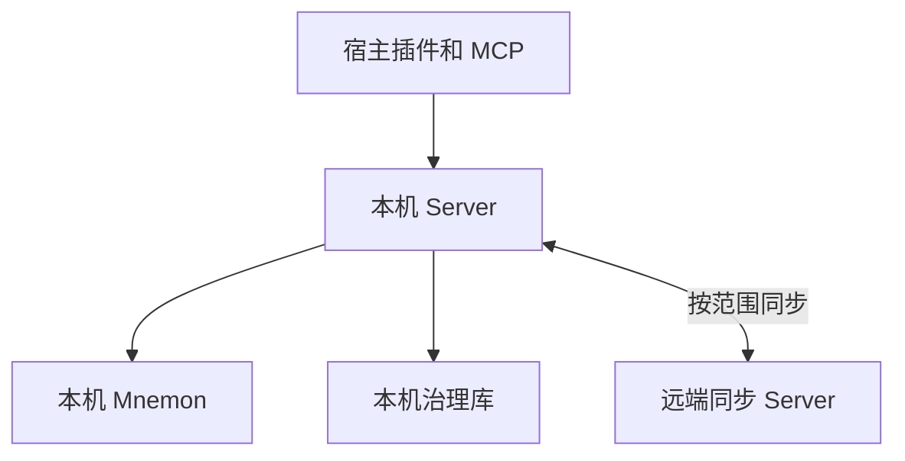

# 架构

MnemoWeave 是面向 DSH、ChatGPT 桌面和 ZCode 的本地记忆服务。三个宿主共用客户端，每台开发机运行一个本机 Server 和一个专用 Mnemon Store。远端同步 Server 为共享条目确认版本。本机负责注入和召回。

## 组件与部署

| 组件 | 代码 | 职责 |
|---|---|---|
| 本机 Server | `apps/server` | 装配 Application Core、Provider、治理库和同步客户端，运行 Worker 与同步循环 |
| Application Core | `packages/core/application` | 授权、候选与发布、版本和冲突、View 装配、同步协调 |
| 契约与协议 | `packages/core/contracts`、`packages/protocols` | Zod 契约、HTTP、stdio MCP、远端同步 HTTP |
| 宿主集成 | `packages/client`、`packages/adapters`、`plugins` | 宿主事件转换、请求本机 Server、渲染 View、DSH 界面 |
| Provider | `packages/providers/mnemon` | 调用官方 Mnemon CLI、校验输出和核对副作用 |
| 持久化与远端 | `packages/infrastructure`、`apps/sync-server` | 治理数据、同步账本、远端 SQLite 版本库、设备管理 |

本机 Server 监听 loopback，Windows 使用登录时计划任务。远端 Server 原生部署于 Linux，由 systemd 托管，TLS 在部署层终止。Worker 位于本机 Server 进程。各组件使用 TypeScript strict 与 pnpm Workspace。

## 数据所有权

| 数据 | 所有者 |
|---|---|
| 正式记忆正文与原生关系 | 本机 Mnemon。治理目录保存当前指针、修订元数据、正文哈希与 Provider ID 映射 |
| 候选、审核、冲突、任务、执行回执和会话投影 | 本机治理库 |
| 运行时准则和项目档案 | 本机治理库保存可读副本；共享变更由远端确认 |
| 共享条目版本、范围序号和设备授权 | 远端同步库 |
| 技能复盘证据、草案与回测结果 | DSH 技能页的会话内状态，持久化状态见 [当前状态](status.md) |

## 设计决策

| 决策 | 实施边界 |
|---|---|
| Source、Strategy、Core、Pipeline 与 View | Source 声明 Capability，Strategy 声明 Plan，Core 校验并协调，Pipeline 执行。View 不可变，实际读写边界强制检查授权 |
| Provider 集成 | 官方 Mnemon 0.2.13 CLI；能力或版本不符时明确拒绝。Provider 内部数据库归 Provider 管理 |
| 模型归属 | 模型推理由宿主会话或宿主任务 Agent 承担。Server 校验输入、执行确定性判断、管理持久化与发布 |
| 发布授权 | 用户通过记忆界面新增、编辑三类记忆，可主动触发任务 Agent 整理后新增。普通模型工具仅提交候选，候选审核由 operator 执行 |
| 可靠写入 | 使用稳定写入键、Outbox、独立 Task/Run/Receipt 和核对流程。结果不明时先对账 |
| 版本治理 | 修订不可变。编辑由读取时的基准版本约束；正式记忆撤回退出召回，保留历史 |
| 注入 | 本机组装与读取。总预算默认 4096 token，客户端截止 2 秒。准则按完整条目处理 |
| 设备同步 | 项目统一使用 `projectId`，Provider ID 每机独立；远端分配条目版本和范围序号 |
| 信任边界 | 服务令牌与 Host 头用于本机认证和宿主归因。operator 管理凭据单独使用。逐设备令牌只供本机 Server 访问远端 |
| 正文可见性 | 远端处理正文封装、哈希与长度。正文是否允许远端读取仍待确认，见 [同步协议](sync.md) |

HTTP/MCP 契约、迁移与配置见 [实现](implementation.md)。宿主证据见 [验收](host-acceptance.md)。
