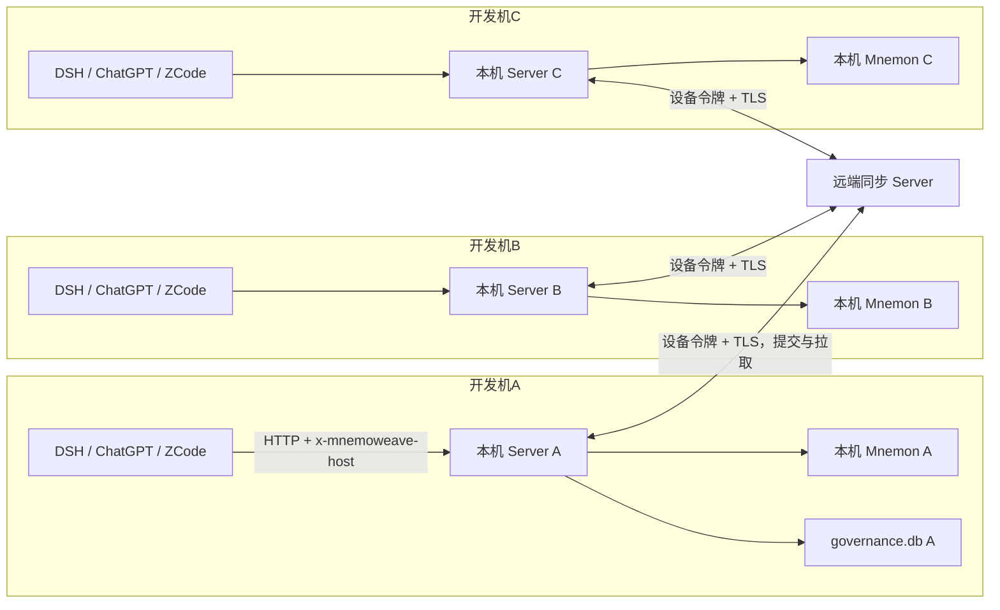

# 架构

## 1. 定位

MnemoWeave 是独立的 AI Agent 记忆编排系统。正式记忆正文、原生实体关系与检索由 **Mnemon** 提供；MnemoWeave 负责候选审核、可靠写入、逻辑版本与冲突治理、多 Host 接入与用户可见的记忆管理。

- 形态：TypeScript（strict）pnpm workspace monorepo、模块化单体、原生部署（不使用 Docker）。
- 拓扑：**三台开发机各一个本机 Server + 本机 Mnemon，另有一台远端同步 Server**。每台机器上的三个宿主插件连接本机 Server；共享写入由远端确认版本，注入与召回走本机。协议与版本模型见 `sync.md`。
- 运行环境：Node.js 24（`engines: >=24 <25`），当前实测 Node 24.22.1、pnpm 11.18.0、TypeScript 7.0.2。
- 后端名称固定为 Mnemon，配置前缀为 `MNEMON_*`，不随项目改名。

## 2. 术语

| 名称 | 含义 |
|---|---|
| Source | 以标准 Capability 暴露数据和操作的组件（`packages/core/application/src/composition.ts`） |
| Provider Adapter | 对真实后端接口的适配，不承载业务、不自行寻找模型（`packages/providers/mnemon`） |
| Strategy / Plan | 声明组合计划，不执行底层操作 |
| Core | 校验 Plan、协调执行、执行授权（`packages/core/application`） |
| Pipeline | 可复用的任务执行机制 |
| View | 不可变注入上下文，按调用方范围过滤；能力声明不等于授权 |
| Candidate | 待审核内容，不能直接当作正式记忆 |
| Task / Run / Receipt | 三者身份独立，关联但不合并为同一记录 |
| Client | `packages/client`：三个宿主插件共用的 Server 客户端，HTTP + 2 秒注入截止 |
| 本机 Server | 每个开发机一个，持有本机 Mnemon 与治理库，是宿主唯一的入口 |
| 远端同步 Server | 唯一权威的变更顺序与版本登记方；不运行 Mnemon，不做注入与召回 |
| Entry / Version | 一条业务记忆（三类之一）与它的整数版本；条目属于一个同步范围，版本由远端分配 |
| Change | 幂等变更：`entryId` + `scope` + `baseVersion` + 全量目标态 + `changeId` |
| Scope | 同步范围：`global`（全局准则）或 `project:<projectId>`；序号、游标、快照、设备授权都以它为单位 |
| Device | 一台本机 Server 在远端的身份，可单独撤销 |

## 3. 包与边界

workspace 包（跨包引用使用相对源码路径 + `.ts`；各 `package.json` 未声明 `main`/`exports`）：

| 路径 | 包名 | 职责 |
|---|---|---|
| `packages/core/contracts` | `@mnemoweave/contracts` | zod 契约：Recall/Remember/Candidate、HostEvent、View、记忆列表与编辑、STORAGE、错误码、OpenAPI |
| `packages/core/application` | `@mnemoweave/application` | `MemoryApplication`、端口定义、`ViewAssembler`、`MemoryRuntime`、`MemoryWorkflow`、`VersionWorkflow`、`SourceRegistry`/`CompositionPipeline` |
| `packages/infrastructure/governance` | `@mnemoweave/governance` | 治理库（`node:sqlite`）：候选/审核/任务/Outbox/回执、记忆目录与 Revision、冲突、会话事件、运行时状态 |
| `packages/infrastructure/model-gateway` | `@mnemoweave/model-gateway` | `ChatModelGateway`、路由、并发上限 2、用量落盘 |
| `packages/protocols/http` | `@mnemoweave/protocols-http` | HTTP 服务器、路由表、`ClientHttpEndpoints` | 
| `packages/protocols/mcp` | `@mnemoweave/protocols-mcp` | stdio MCP 服务器与工具注册 |
| `packages/providers/mnemon` | `@mnemoweave/providers-mnemon` | 官方 Mnemon CLI 适配（固定版本、串行调用、输出校验） |
| `packages/client` | `@mnemoweave/client` | 宿主共用客户端：HTTP 调用、注入截止、View 文本渲染 |
| `packages/adapters/shared-sdk` | `@mnemoweave/adapters-shared-sdk` | 注入控制器、注入触发类型、适配器描述符校验 |
| `packages/adapters/chatgpt` | `@mnemoweave/adapters-chatgpt` | ChatGPT 桌面 local-only command hooks 适配与配置生成 |
| `packages/adapters/zcode` | `@mnemoweave/adapters-zcode` | ZCode workspace hooks 安装、事件归一化、注入 |
| `packages/adapters/dsh` | `@mnemoweave/adapters-dsh` | 仅 `DSH_HOST_FACTS`（`status: 'blocked'`），无 hook 入口 |
| `packages/infrastructure/sync-store` | `@mnemoweave/sync-store` | 远端权威库（`node:sqlite`）：设备与范围授权、变更日志、条目当前态与 Revision、幂等凭证 |
| `packages/infrastructure/sync-client` | `@mnemoweave/sync-client` | 本机到远端的 HTTP 客户端：超时、错误映射、未发出 / 结果未知的区分 |
| `packages/protocols/sync-http` | `@mnemoweave/protocols-sync-http` | 远端同步路由与设备鉴权，与宿主面 `protocols/http` 分离 |
| `apps/server` | `@mnemoweave/server` | 本机组合根：HTTP 服务（默认 4317）、stdio MCP 入口、同步循环 |
| `apps/sync-server` | `@mnemoweave/sync-server` | 远端组合根：同步服务、设备签发 CLI、systemd 单元 |

以下目录只有 README、没有 `package.json` 与源码，**不构成包**：`packages/domain`、`packages/shared`（`packages/core` 是分组目录）。

边界规则：

- 协议层只转换输入输出；Application 负责授权、校验与用例编排；领域不依赖协议、进程或数据库。
- `apps/server` 是本机组合根，负责装配 Provider、治理库、网关与运行时；`apps/sync-server` 是远端组合根，只依赖契约与 `sync-store`，不依赖治理库与 Provider。领域层不得反向引用 `apps/`。
- 宿主插件只通过 `packages/client` 访问 Server，不直接读治理库、不直接调 Mnemon。

## 4. 进程与部署

| 组件 | 端口/形态 | 说明 |
|---|---|---|
| 本机 Server | `127.0.0.1:4317`（`MNEMOWEAVE_PORT`） | HTTP + 进程内 Worker + 同步循环；Windows 开发机由登录时启动的计划任务托管 |
| 远端同步 Server | HTTPS（部署层终止 TLS） | 设备鉴权、版本登记、按 `seq` 分发、快照；Linux 由 `apps/sync-server/deploy/mnemoweave-sync.service` 托管 |
| MCP | stdio | 默认代理到本机 Server；`MNEMOWEAVE_MCP_MODE=standalone` 时进程内直连（Worker 关闭） |
| 宿主插件 | 进程内 / 短命子进程 | DSH 在宿主进程内调用（RPC → HTTP）；ZCode/ChatGPT 是钩子子进程，每次调用后退出 |

部署约定：本机 Server 与宿主必须同机（客户端的 `baseUrl` 只接受 loopback）；远端同步 Server 独立部署，不与任何开发机共用磁盘。Worker 暂留本机 Server 进程内；不使用 Docker，不修改系统 PATH。本机 Server 首版不做 Windows 服务包装，计划任务绑定用户会话，注销即停止。

## 5. 数据所有权

| 数据 | 权威 |
|---|---|
| 正式记忆正文、原生实体关系、检索 | Mnemon（只用官方接口） |
| 候选内容、审核记录、Provenance 扩展 | MnemoWeave |
| Task、Run、Receipt、Outbox | MnemoWeave |
| Revision 正式全文 | Mnemon |
| Revision 映射、内容哈希、当前指针 | MnemoWeave 治理账本 |
| 会话事件与运行时投影 | MnemoWeave（有界、限期） |
| 按范围的序号、条目版本、撤回记录 | 远端同步 Server |
| 待提交变更、待应用变更、**按范围**的拉取游标 | 各机本机 Server（`sync_outbox`、`sync_inbox`、`sync_state`） |
| 逐机 Mnemon ID 映射 | 各机本机 Server（`formal_map`，互不相同） |
| 运行时准则与项目档案正文 | 本机 Server 为工作副本，远端保存确认与恢复用的副本 |

治理库版本化迁移、升级前备份；Provider 自行管理内部迁移。**禁止直接读写 Mnemon 内部表**——不是产品接口。v8 迁移留下的 `sync_log`、`sync_grants`、`sync_license_state` 已由 v11 迁移删除（每步迁移前都有 `VACUUM INTO` 快照）。远端库是独立文件，自带 schema，与治理库不共享迁移。

## 6. 安全边界

- Server 只绑定 `127.0.0.1`，除 `/health/live` 外都要求 `Authorization: Bearer <MNEMOWEAVE_TOKEN>`；拒绝带 `Origin` 的请求。
- 宿主与 Server 之间只有一种身份：**服务令牌 + `x-mnemoweave-host` 头**。不再签发逐 Host 凭据，也不做配对与撤权代数。
- 人工例外处理走独立 `MNEMOWEAVE_OPERATOR_TOKEN`，只在 HTTP 边界校验；MCP 不暴露 review/retry 工具，operator token 不得进入 Host 环境。
- 用户编辑正式记忆走 `PATCH /v1/memories/{id}`，写入被记录为 `local-user` 的审核决定；模型没有这个入口。
- 本机 Server 到远端使用**逐设备令牌**，设备可单独撤销；九个宿主实例不持有同步凭据。远端拒绝带 `Origin` 的请求，TLS 由部署层终止。
- 远端是否可读正文**待确认**；无论结论如何，它的校验、去重与快照只依赖 `contentHash` 与 `byteLength`，不解析正文语义。正文封装保留 `enc-v1`；只封装正文时，标题、证据、实体、关系仍是明文。
- 授权分层：本机决定「发起者能否做这个动作」，远端只决定「设备能否读写这个范围」。宿主没有写准则、写档案或发布正式记忆的入口。
- 模型输出视为不可信数据，按严格 Schema 校验；拒绝、截断、解析失败一律转人工。
- 当前实现是受保护的本机开发边界；对外暴露前仍需身份体系、TLS 与密钥托管评审。

## 7. 仍影响当前实现的决策

| 决策 | 代码落点 |
|---|---|
| 正式正文权威在 Mnemon，MnemoWeave 只存映射、哈希、指针与审核素材 | `catalog_revisions`、`governance_candidate_bodies` |
| 只使用官方 CLI，不碰 Provider 私有 Web/内部表 | `packages/providers/mnemon/src/index.ts` |
| Mnemon 由环境提供：`MNEMON_BINARY` 可省略，默认 PATH 上的 `mnemon` | `apps/server/src/config.ts`、`createRunner` |
| 只接受已验收版本 0.2.13，其余明确拒绝 | 版本字面量校验 → `UNSUPPORTED_VERSION` |
| 模型输出只能成为候选，不能直接写正式记忆 | `MemoryWorkflow` 审核分支；`REVIEW_REQUIRED` |
| 用户可直接编辑正式记忆，编辑追加不可变 Revision 并记录审核决定 | `catalog.publishDirectEdit` + `PATCH /v1/memories/{id}` |
| 跨 Provider 写入用 Outbox + 稳定 writeKey + 独立 Run/Receipt，超时只对账不重试 | `governance_tasks`/`governance_outbox`/`governance_execution_receipts`/`catalog_operations` |
| Revision 不可变，更新用 CAS + 业务占用 + 前向恢复 | `catalog_revisions` 不可变触发器、`catalog_reservations` |
| 注入预算 4096 token、2 秒截止，超时不重复召回 | `DEFAULT_INJECTION_BUDGET_TOKENS`、客户端 `INJECTION_TIMEOUT_MS` |
| 宿主不跑本地代理；断网时使用已同步到本机的副本（**规格**） | `packages/client` 直连本机 Server；`sync_inbox`/`sync_state` 持久化已应用变更 |
| 宿主身份 = 服务令牌 + Host 头；本机 Server 到远端再用逐设备令牌（**规格**） | `createHttpServer` 的 `requireHost()`；`packages/protocols/sync-http` |
| 共享写入由远端确认版本，注入与召回走本机（**规格**） | `SyncCoordinator`（`packages/core/application`）、`apps/sync-server` |
| 变更携带全量目标态，版本与顺序由远端分配（**规格**） | `packages/core/contracts` 同步契约；远端 `changes`/`entries` |
| 三机共用 `projectId`，Mnemon 原生 ID 各机独立（**规格**） | `formal_map`、`project_bindings` |
| 是否允许远端读取正文待确认；校验与快照只依赖哈希与长度；`enc-v1` 只封装正文（**规格**） | `docs/sync.md` 第 5 节 |
| 每个同步范围独立序号、游标与快照；全局准则为单独范围（**规格**） | `sync_state`、远端 `changes(scope_id, seq)` |
| 编辑基准来自读取接口返回的版本，服务端不补全（**规格**） | `GET /v1/memories/{id}` 的 `entryVersion`；`PATCH` 必填 |
| 准则按完整条目注入，超预算拒绝启用而非截断（**规格**） | `runtime_rules`、`RULE_BUDGET_EXCEEDED` |
| 宿主不能写准则、档案或发布正式记忆；本机校验发起者（**规格**） | 授权矩阵（`docs/sync.md` 第 10 节） |
| 模块化单体、原生部署、Worker 进程内 | `pnpm-workspace.yaml`、`apps/server/deploy/mnemoweave.service` |
