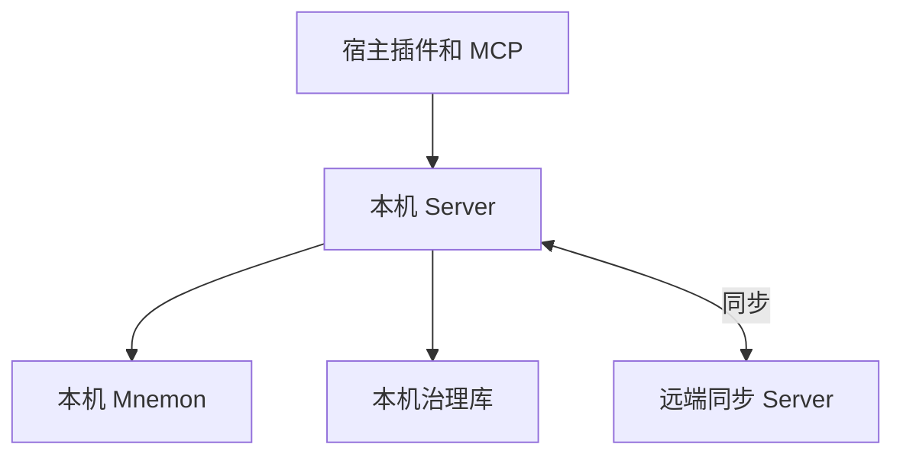

# 架构

MnemoWeave 是面向 DSH、ChatGPT 桌面和 ZCode 的本地记忆服务。三个宿主共用客户端，每台开发机运行一个本机 Server 和一个专用 Mnemon Store。远端同步 Server 为共享条目确认版本。本机负责注入和召回。

本文定义目标架构。各项交付状态以 [当前状态](status.md) 为准。

## 统一术语

| 术语 | 定义 |
|---|---|
| 准则 | 各会话共用、按轮注入的规则。同步类型为 `rule`。界面页签名为「准则」 |
| 工作区档案 | 跨会话保留、按工作区存放的文档，可归档、恢复和读取版本历史。同步类型为 `workspace-archive` |
| 正式记忆 | 通过发布产生、由 Mnemon 保存正文和原生关系的共享记忆。同步类型为 `formal-memory` |
| 工作上下文 | 由宿主管理的当前任务、进度和会话内容。MnemoWeave 按授权任务需要读取 |
| 工作区 ID | `workspaceId`。跨设备共享的 UUID，用于工作区档案。设备各自绑定本地根目录 |
| 召回线索 | 用于正式记忆检索的可选工作区名称。只影响查询相关性 |
| 同步流 | 序号、游标和快照的单位。同步层从条目类型和工作区档案的工作区 ID 派生 |
| 写入任务 Agent | 由宿主启动、工具受限的独立 Agent，输出结构化写入计划 |
| 候选 | 尚未发布的正式记忆提案。只有正式发布更新目录的当前指针 |
| 修订 | 一次发布或编辑生成的不可变记录。同步协议类型名为 `Revision` |
| 条目版本 | 写入并发控制用的整数。正式记忆字段为 `entryVersion`，准则和工作区档案提交字段为 `baseVersion` |

正文和界面统一使用上表术语。代码、接口、环境变量和历史数据中的标识保持其字面名称。

## 组件与部署

| 组件 | 代码 | 职责 |
|---|---|---|
| 本机 Server | `apps/server` | 装配 Application Core、Provider、治理库和同步客户端，运行 Worker 与同步循环 |
| Application Core | `packages/core/application` | 授权、候选与发布、版本和冲突、准则读取、同步协调 |
| 契约与协议 | `packages/core/contracts`、`packages/protocols` | Zod 契约、HTTP、stdio MCP、远端同步 HTTP |
| 宿主集成 | `packages/client`、`packages/adapters`、`plugins` | 宿主事件转换、请求本机 Server、渲染常驻准则、适配宿主界面 |
| Provider | `packages/providers/mnemon` | 调用官方 Mnemon CLI、校验输出和核对副作用 |
| 持久化与远端 | `packages/infrastructure`、`apps/sync-server` | 治理数据、同步账本、远端 SQLite 版本库、设备管理 |

本机 Server 监听 loopback，Windows 使用登录时计划任务。远端 Server 原生部署于 Linux，由 systemd 托管，TLS 在部署层终止。Worker 位于本机 Server 进程。各组件使用 TypeScript strict 与 pnpm Workspace。

## 数据所有权

| 数据 | 所有者 |
|---|---|
| 正式记忆正文与原生关系 | 本机 Mnemon。治理目录保存当前指针、修订元数据、正文哈希与 Provider ID 映射 |
| 候选、审核、冲突、任务、执行回执、会话绑定与记忆操作证据 | 本机治理库 |
| 准则和工作区档案 | 本机治理库保存可读副本；共享变更由远端确认 |
| 共享条目版本、同步流序号和设备凭据 | 远端同步库 |
| 技能复盘证据、草案与回测结果 | DSH 技能状态目录，交付状态见 [当前状态](status.md) |

## 设计决策

| 决策 | 实施边界 |
|---|---|
| 读取与授权 | Application Core 与本机 Server 协调读取，Provider 执行 Mnemon 操作，实际读写边界强制检查授权 |
| Provider 集成 | 官方 Mnemon 0.2.13 CLI；能力或版本不符时明确拒绝。Provider 内部数据库归 Provider 管理 |
| 模型归属 | 模型推理由宿主会话或宿主任务 Agent 承担。Server 校验输入、执行确定性判断、管理持久化与发布 |
| 发布授权 | 用户可直接新增、编辑三类记忆。主会话可通过 `remember` 主动提出有工程证据的通用经验，也可提出用户明确提供的长期事实。主会话通过本机 Server 提交候选，正式发布走人工审核。用户发起的整理与提炼按各自确认契约提交，撤回要求用户明确指定目标 |
| 可靠写入 | 使用稳定写入键、Outbox、独立 Task/Run/Receipt 和核对流程。结果不明时先对账 |
| 版本治理 | 修订不可变。编辑由读取时的基准版本约束；正式记忆撤回退出召回，保留历史 |
| 工作区档案隔离 | 每条档案只属于一个工作区。同一工作区的会话共享档案，列表、搜索、历史、写入、容量和同步均以工作区 ID 为边界。同步开启时归档状态以远端确认版本为准 |
| 档案提炼 | 用户可从一篇工作区档案生成正式记忆草稿，确认共享后走正式写入流程。来源元数据留在本机。容量维护可在发布或确认重复后执行另行确认的来源归档 |
| 正式记忆共享 | 正式记忆使用一个专用 Mnemon Store。同步使用 `formal-memories` 流。每台获授权的设备可读取整套已应用正式记忆。本机 Server 与 Application Core 协调授权、检索、查重、预算与同步。正式记忆条目无工作区字段。工作区名称可作为召回线索 |
| 注入 | 当前可见的启用准则全文常驻，按轮读取，客户端截止默认 2 秒。工作区档案与正式记忆按需读取，移除聚合 View |
| 空闲复盘 | 每次最多变更一条通用准则并新增一篇工作区档案，不写正式记忆 |
| 技能总结 | 用户发起，任务 Agent 根据选定会话和同一工作区的已授权档案起草。技能回测和采纳各自独立 |
| 设备同步 | 准则、正式记忆和每个工作区的档案各有独立同步流，Provider ID 每机独立；远端分配条目版本和同步流序号 |
| 信任边界 | 服务令牌与 Host 头用于本机认证和宿主归因。operator 管理凭据单独使用。逐设备令牌只供本机 Server 访问整个远端同步库 |
| 正文可见性 | 远端处理正文封装、哈希与长度。正文是否允许远端读取仍待确认，见 [同步协议](sync.md) |

HTTP/MCP 契约、迁移与配置见 [实现](implementation.md)。宿主工具通过 DSH 原生注册或 stdio MCP 提供，准则通过宿主的提示词组装或 Hook 注入，见 [宿主工具注册](implementation.md#宿主工具注册) 和 [宿主准则注入](implementation.md#宿主准则注入)。宿主证据见 [验收](host-acceptance.md)。
