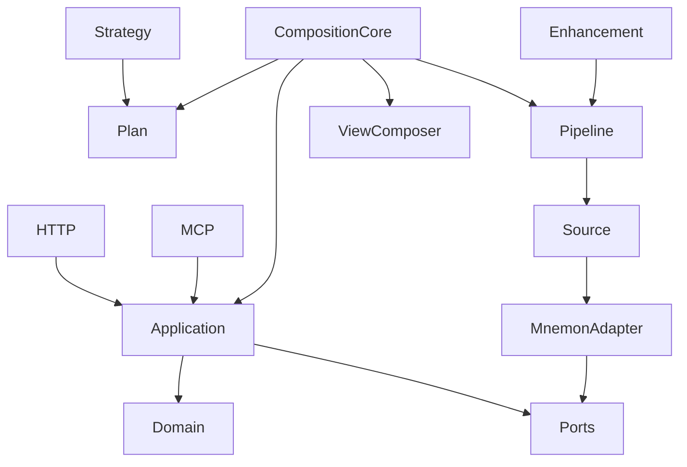

# 模块与依赖

协议层只转换输入输出；Application 执行授权、校验和用例；Domain 不依赖协议、进程或数据库。Adapter 实现 Ports。Server 负责组装依赖，不能反向让领域引用基础设施。

初始可执行包按二级分组组织：core/contracts、core/application、infrastructure/governance、infrastructure/model-gateway、providers/mnemon、protocols/http、protocols/mcp、apps/server。保留模块位置：core 组内未来模块、domain、bridge、adapters/shared-sdk、adapters/dsh、adapters/codex、adapters/zcode、shared。后者只记录边界，未宣称实现功能。暂不把每个内部模块拆成独立服务。

当前实际包、依赖方向与预留目录状态见 `../implementation/module-and-dependency.md`；只有 README 的目录不得当作已实现模块。

后续领域按 memory、governance、tasks、sync 分模块，在模块内组织 domain/application/ports；禁止跨模块直接访问表。
