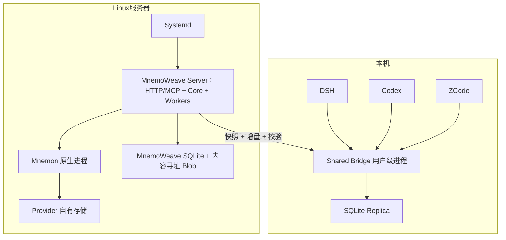

# 原生部署

Linux Server 使用 systemd；Linux Bridge 使用 systemd --user；Windows Bridge 使用适配用户会话的后台进程。Worker 暂不独立部署。无 Docker 前提。

当前首切片仅本地开发验收，不代表远端部署、Bridge 或同步已完成。Server 与 Mnemon 位于同一服务器，通过官方 CLI 调用；不暴露 Mnemon 私有 Web API。
