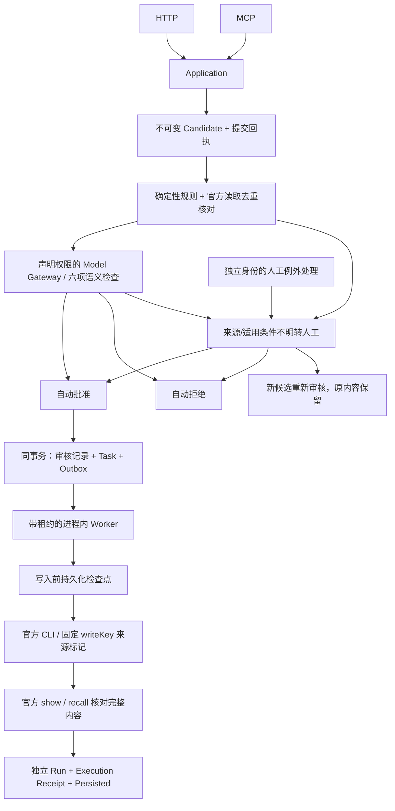

# 新记忆审核与可靠写入里程碑

目标：HTTP/MCP 提交候选，审核后可靠写入 Mnemon，实际重启后仍可查询正式记忆与追溯结果。基线为用户补齐的 ADR-015、ADR-019、ADR-025、ADR-026；不将完整 Revision/Replica/Bridge 工程纳入本里程碑。

## 实现边界

协议入口只提交候选，不能携带 approved 越过审核。HTTP 人工入口独立鉴权，MCP 没有 approve/review/retry 工具。Model Gateway 只允许 candidate-review 组件调用单条显式配置路由，没有 Provider 自寻模型或隐式降级；无模型、无效 JSON、拒绝/截断、不确定结论均转人工。六项检查和审核结论完整持久化；申报 verified/模型 confidence 均不作为单独批准依据。

重要架构记忆、Global 晋升、未知事实、冲突强制人工。内容相同但适用范围/证据不同或未知，不简单判重复。对真实冲突创建 conflict 审核任务并停写；当前不支持覆盖/Revision 更新/替代事务，因此这些冲突不能通过 approve 变成新的独立确定事实。可拒绝、保留待审或澄清条件后提交新候选；不删除已有正式记忆。

## 可靠性语义

- 候选和提交回执同事务；批准结论、正式 Task、Outbox 同事务。Task、Pipeline Run、Execution Receipt 的 ID 独立关联。
- 稳定写入键为 candidate:<UUID>，存于 Task/Receipt，并传给 Mnemon --source。原生 CLI 没有声明支持此幂等协议，因此不能把 source 标记当作 Provider 原生 exactly-once 保证。
- 同一个治理库使用共享租约串行化调度，所有 mutation 以 owner fencing 防止过期 Worker 回写。Heartbeat 延长租约；重启等待旧租约到期，不因进程消失立即绕过。
- 写入前检查点 writing 持久化后才发起 Provider 调用。完成条件是官方 show 核对 ID 与全文内容一致，并在事务中保存成功回执及 Persisted。
- 进程中断或响应丢失：恢复 writing 任务只对账，不再发起新写入。找到唯一明确结果则补记回执；没有明确结果或查询截断则 Failed，等人工确认原进程停止、核对后再重试。
- 尚未发起写入的可确定故障，最多三次退避重试。重试使用同一 Task/writeKey、新的 Run 和 Receipt，保留失败记录。
- 只使用官方 CLI，禁止内部表依赖。每次原生子进程设置 MNEMON_MAX_INSIGHTS=0，避免默认自动清理历史。使用专用 Store；不承诺与其他旁路写入者之间的全局唯一性。
- 治理库绑定 Provider 数据目录及 Store，防止重启后将原 Outbox 发到另一个后端。正式内容仍由 Mnemon 权威保存；治理库只保留审核素材、关联、哈希与回执，不声明独立正式内容权威。

## Schema 与恢复

v2 在 v1 不可变候选/提交回执之上，增加 lifecycle、reviews、review_tasks、tasks、outbox、runs、execution_receipts、provider_binding、workflow_lock；没有提前冻结完整业务/Revision/同步 Schema。v1→v2 前由 VACUUM INTO 产生带唯一名的一致快照，迁移同事务提交。旧请求新增默认 scope 后仍使用规范化输入校验幂等性，避免升级后同键误报冲突。

快照只用于治理库恢复，不能回滚 Provider。先停所有相关进程、保留现库，再复制快照到新的状态目录并启动，不能覆盖现有用户目录。正式记忆仍需使用保存的 Provider ID、内容哈希和官方读接口核对。

## 完成证据与实际限制

tests/e2e/reliable-memory.test.ts 使用真实官方 Windows Mnemon、HTTP Server 与独立 MCP 子进程，覆盖两个入口自动审核后写入、人工 approve/reject/amend、普通令牌不能审核、冲突不能越权批准、重启后 Recall 和回执保持。

第二个 E2E 在真实 Mnemon 提交后、治理回执提交前杀死测试 Worker，等待真实租约过期，再启动 Server；恢复后 receipt.reconciled=true，官方 status.total_insights=1，保留 interrupted 和 succeeded 两个 Run。测试注入只在 tests/support/crash-worker.ts，无生产故障后门。

workflow Contract 另覆盖原子 Outbox 回滚、租约 fencing、明确失败重试、未知结果不重发、旧数据迁移和备份。CLI 行为测试在父环境容量 1、无宽限的情况下写两条并建立 Link，确认本项目禁用自动清理后旧内容仍可访问。

本轮语义端点为本地确定性测试服务，证明协议、校验和分流行为，不证明真实模型的事实判断质量。用户可显式配置兼容服务；未配置时仍可通过人工例外流程运行。版本/替代事务与冲突裁定已另有主路径实现（见 revision-conflict-proposal.md 与 `../implementation/state-machines-and-transactions.md`）；生产身份、TLS、完整模型路由、时间/事件复核、Replica、Bridge 和 Host Adapter 仍待实施。
