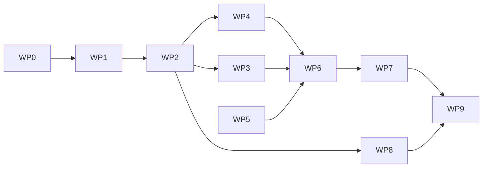

# 实现工作包

状态：工作包顺序是工程建议（Proposed），不是新的架构决策；每个包的范围来自已确认政策与当前实现缺口。开始新包前先确认依赖包已完成，不得并行扩张未评审的 Schema。

## WP0 文档与基线校正（完成）

- 输入：ADR-001–026、15 批确认、当前代码。
- 输出：本目录 15 份文档、README 校正、参考项目评估更新。
- 完成条件：文档与代码事实一致；失效引用清除；未决项集中登记。
- 禁止：借校正之机修改已确认决策。

## WP1 契约补全

- 输入：`contract-catalog.md`、当前 `openapi` 定义。
- 输出：`/openapi.json` 覆盖冲突读取、冲突裁定、版本取消；`/v1/remember` 描述与 change 语义一致；错误码与状态映射有测试。
- 完成条件：OpenAPI 与实际路由逐条对应；契约测试能在缺路径时失败。
- 禁止：只改文档不改生成源；不得顺手改变现有字段含义。

## WP2 状态机与可靠性对齐

- 输入：`state-machines-and-transactions.md`。
- 输出：
  - Outbox 独立派发或明确记录“随 Task 推进”的最终决定，并删除误导性状态。
  - 重试退避与已确认政策对齐（封顶 15 分钟、24 小时告警），或记录偏离决策。
  - 默认 Recall 过滤改为先过滤后分页，消除 100 条截断。
  - 人工 approve 的冲突拦截覆盖无审核记录的情况。
- 完成条件：contract 覆盖每个状态迁移与故障窗口；并发与重启测试通过。
- 禁止：在未迁移旧数据的情况下改变状态枚举语义。

## WP3 模型网关与路由

- 输入：`model-gateway-and-routing.md`、MODEL-01 至 MODEL-06。
- 输出：任务→能力→路由表；60 秒/5 分钟/3+1 预算；后台并发 2；用量记录（unknown 不记零）；失败分类。
- 完成条件：无模型时行为不变（转人工）；预算与并发有可测证据；凭据不出现在日志与回执。
- 禁止：让 Provider 自寻模型；用重试绕过语义不确定。

## WP4 View、Recall 与预算

- 输入：ADR-013/014/024、`recall-and-view.md`、VIEW-01/02、RECALL-01/02。
- 输出：不可变 View 结构与 ReadGrant 形态（借鉴参考项目的 generation/lease，但自有字段）；4,096 Token 兜底；关键 Pinned 超限异常；可选重排。
- 完成条件：权限、版本、预算三者在交付前检查；迟到结果不能回写旧请求。
- 禁止：把 View 当持久存储；用模型分数替代事实判断。

## WP5 Session 事件与生命周期

- 输入：HOST-03、RETENTION-01/02、OPS-01、`lifecycle-and-retention.md`。
- 输出：事件归一与去重、选择性保存、7+90 天生命周期、受保护证据、候选 30 天清理、诊断日志 30 天。
- 完成条件：清理不删除正式历史与证据；时限从正确时点计算；任务延迟不重置期限。
- 禁止：无限保存会话；清理时删除审核记录。

## WP6 Bridge 与同步

- 输入：`bridge-and-sync.md`、SYNC-01 至 SYNC-06、AUTH-01 至 AUTH-05。
- 输出：契约与 Schema 评审 → Bridge 进程 → 配对与许可 → 副本与离线队列 → 快照/增量/校验/重建。
- 完成条件：`bridge-and-sync.md` 第 8 节验收全部通过；用户默认目录不被触碰。
- 禁止：在协议未评审前建表；用 Git 分支模型替代授权副本；本地批准。

## WP7 Host 适配器

- 输入：`host-integration.md`、HOST-01 至 HOST-06。
- 输出：DSH 适配器先行（版本区间确认后），再 Codex、ZCode；事件采集、自动注入、故障提示、验收记录。
- 完成条件：三个 Host 均通过必需项；任一阻塞则首版不完成。
- 禁止：MCP 代替自动注入；读取 Host 私有数据库；伪造 Hook 能力。

## WP8 部署与运维

- 输入：`configuration-deployment-upgrade.md`。
- 输出：systemd 单元、Windows Bridge 后台、诊断与告警、容量配额、迁移演练。
- 完成条件：升级与回退可复现；磁盘不足不产生部分写入；日志脱敏。
- 禁止：生产环境开放无 TLS 的远端访问。

## WP9 验收加固

- 输入：`test-and-acceptance-matrix.md`。
- 输出：并发、多进程、时钟漂移、旧 Cursor、数据规模迁移的测试；全量 E2E 回归。
- 完成条件：矩阵中“覆盖不足/未验证”项转为已验证或有明确阻塞记录。

## 包间依赖

WP6 依赖 WP2（意图状态机）、WP3（模型预算）与 WP4（View 契约）；WP7 依赖 WP6 的本地副本与事件入口。

## 2026-11-09 修复补充

本轮实际运行时、projectId 授权、逐 Host 凭据、capture 状态机、v10 迁移和同步一致性以 [runtime-memory.md](runtime-memory.md) 的实现细化及 [current-handoff.md](current-handoff.md) 的实测状态为准。旧章节的“已实现”不表示真实 Host 验收已完成；未决同步 Schema 和身份体系细节不因原型代码而冻结。
