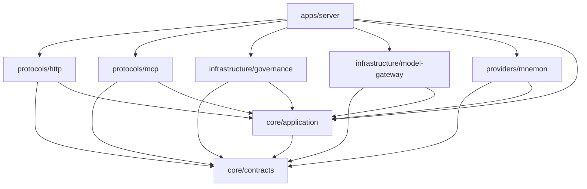

# 模块与依赖

状态：包结构与依赖方向为当前实现事实；目标模块划分见 ADR-008、ADR-022、ADR-026 与 `../architecture/component-architecture.md`。新增模块必须先在此登记，不得先建目录后补文档。

## 1. 当前包布局

| 路径 | 包名 | 职责 | 当前状态 |
|---|---|---|---|
| `packages/core/contracts` | `@mnemoweave/contracts` | Zod 契约、错误码、OpenAPI 定义；是 TS 类型、MCP inputSchema 与 HTTP 文档的唯一来源 | 已实现 |
| `packages/core/application` | `@mnemoweave/application` | Application Core：Recall、候选提交、读取、审核、冲突、版本工作流与 Ports | 已实现 |
| `packages/infrastructure/governance` | `@mnemoweave/governance` | 治理库（SQLite）、生命周期、Task/Outbox/Receipt、版本目录与冲突案件 | 已实现 |
| `packages/infrastructure/model-gateway` | `@mnemoweave/model-gateway` | 任务→能力→路由表、主/备路由、预算、失败分类与用量记录 | 已实现 |
| `packages/providers/mnemon` | `@mnemoweave/providers-mnemon` | 官方 Mnemon CLI 适配器，固定 0.2.13 | 已实现 |
| `packages/protocols/http` | `@mnemoweave/protocols-http` | HTTP 协议层、鉴权、错误映射 | 已实现 |
| `packages/protocols/mcp` | `@mnemoweave/protocols-mcp` | stdio MCP 工具层 | 已实现 |
| `apps/server` | `@mnemoweave/server` | 组合根：配置、依赖装配、HTTP/MCP 入口、Worker 启动 | 已实现 |
| `packages/bridge` | `@mnemoweave/bridge` | 本地副本、同步游标、离线意图队列与撤权 | 已实现 |
| `packages/adapters/shared-sdk` | `@mnemoweave/adapters-shared-sdk` | 注入控制器（HOST-04/05/06）与适配器能力声明契约 | 已实现并接入 Bridge/ZCode |
| `packages/adapters/{zcode,codex}` | `@mnemoweave/adapters-zcode`、`@mnemoweave/adapters-codex` | Host 事件归一、注入入口与配置生成 | 已实现 |
| `packages/adapters/dsh` | `@mnemoweave/adapters-dsh` | DSH 阻塞记录（桌面已装，Harness CLI 未就绪） | 未实现 |
| `apps/bridge` | `@mnemoweave/bridge-app` | Bridge 进程入口：HTTP 通道、30 秒增量、意图排空 | 已实现 |

以下目录只有 `README.md`，是预留位置，不构成已实现模块：`packages/domain`、`packages/shared`。其余模块状态见上表；`packages/adapters/dsh` 仅有阻塞记录（桌面已装，Harness CLI 未就绪），能力声明与逐 Host 验收见 `../implementation/host-acceptance/`。

## 2. 依赖方向

强制规则：

- 领域规则不依赖协议、数据库、进程或文件系统实现；现状中 `core/application` 只依赖 `core/contracts`。
- 协议层只负责转换、鉴权与错误映射，不承载业务判断。
- Ports 由 Application 定义，Adapter 实现；`apps/server` 负责装配，不能被下层反向依赖。
- 基础设施模块之间不得直接互相引用；跨模块协作通过 Application Port 或组合根。
- 任何模块不得直接打开其他模块的数据库文件或表。

## 3. 包声明与实际依赖

- 每个包在 `package.json` 中声明其 workspace 依赖；声明必须覆盖实际 import，禁止借用上层传递依赖。
- 当前 import 使用显式相对源码路径（例如 `../../contracts/src/index.ts`），依赖声明用于记录边界；独立发布与 `exports` 字段尚未设计。
- 新增第三方依赖需说明用途、版本固定方式与是否影响运行时离线能力。

## 4. 规划中的模块

按 ADR-022/026，后续在模块内组织 `domain/application/ports`，禁止跨模块直接访问表：

| 模块 | 职责 | 进入条件 |
|---|---|---|
| `domain` | 跨用例的领域规则与类型（若 Application 内聚不足再拆分） | 出现被两个以上用例复用的规则 |
| `bridge` | 共享 Bridge 进程、本地副本、离线队列、Host 接入 | 契约目录与状态机稳定、副本 Schema 完成评审 |
| `adapters/dsh` | DSH 事件采集与注入适配 | DSH 目标版本与 Hook 契约验收通过 |
| `adapters/codex` | Codex MCP/Hook 适配 | 本机版本能力核验通过 |
| `adapters/zcode` | ZCode MCP/Hook/Skill 适配 | 本机版本能力核验通过 |
| `adapters/shared-sdk` | 三个适配器共享的事件/身份/重试封装 | 两个以上适配器出现重复实现 |
| `shared` | 日志、时钟、ID 等无业务语义工具 | 出现跨模块复用的基础设施代码 |

## 5. 已知偏差

- `apps/bridge` 已实现（WP7 接线）：`http-channel.ts`（同步协议 HTTP 通道）与 `main.ts`（进程入口：30 秒增量、配对取回、意图排空）；依赖 `packages/bridge` 与 `packages/protocols/http` 的契约。

- `apps/server/src/config.ts` 直接 import 各实现包并装配，属于组合根允许范围；但配置校验与依赖构造混在同一函数，后续拆分时不得改变启动语义。
- 测试通过 `tests/support/server.ts` 直接启动 Server 进程，属于验收工具，不是生产入口。
- `packages/*/node_modules` 是 pnpm workspace 链接，不得作为发布产物或手工修改。

## 2026-11-09 运行时补齐

- core/application 新增 access、composition、runtime；SourceRegistry、Strategy Plan 校验与只读 Pipeline 已接入 View 交付。模型提炼只经过 Gateway，不由 Provider 调用。
- infrastructure/governance/runtime-store 管理 v10 的项目登记、固定引用、有界会话素材、capture Task/Run/Receipt；formal 全文权威不变。
- apps/server/http-memory-client 是 stdio MCP 的传输代理；默认 MCP 不打开治理库或创建 Worker。
- apps/bridge 支持一个共享进程的多个 Host profile；每个 Host 独立凭据、目录、许可、队列与注入控制器。
- 已按实际 import 补齐 package.json 与 pnpm-lock.yaml；内置 Source 路由可用不代表第三方插件生态、热更新或每个 Host 适配均已完成。

- packages/adapters/chatgpt：基于官方文档的本地模式 hook/MCP 配置与进程入口；程序化验证存在，真实桌面能力仍保持 unverified。
