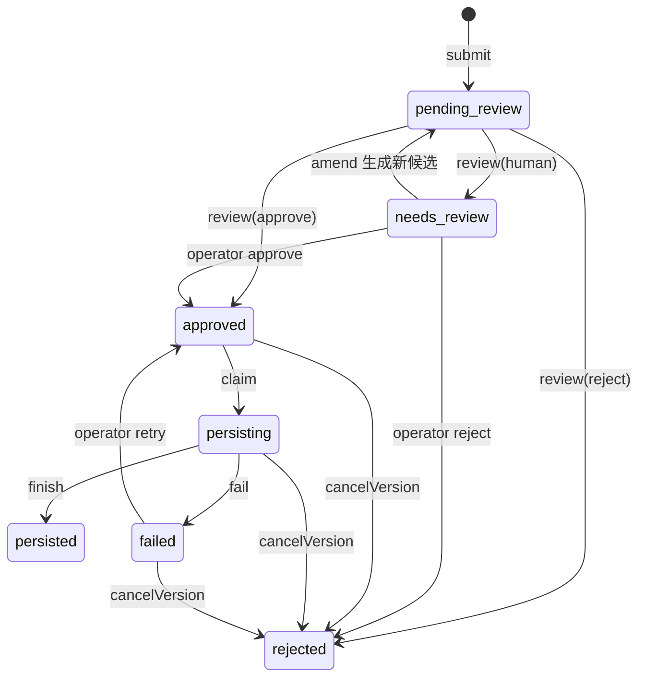
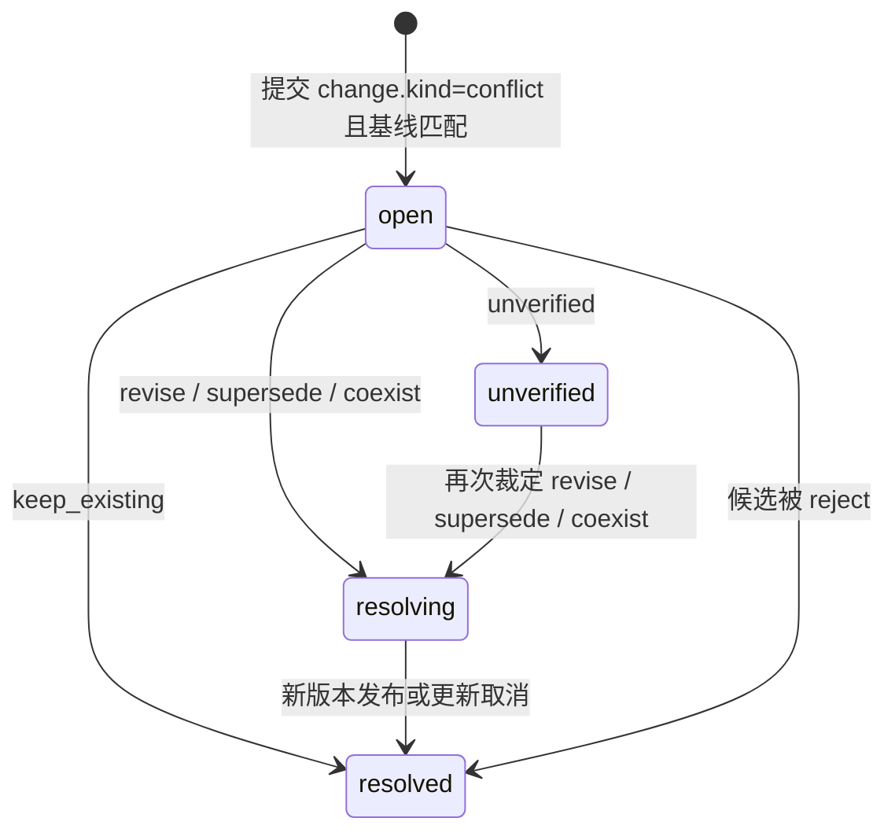

# 状态机与事务

状态：本文描述当前实现的状态与事务边界，属于实现事实；已确认的策略目标见 `../adr/README.md`、`reliable-write-milestone.md`、`revision-conflict-proposal.md`。两者不一致处在第 9 节列出，不得用代码现状替代决策。

## 1. 实体

| 实体 | 记录表 | 身份 |
|---|---|---|
| Candidate | `governance_candidates` + `governance_lifecycle` | 候选 UUID；`request_json` 不可变 |
| Review | `governance_reviews` | 每次决定独立记录 |
| Review Task | `governance_review_tasks` | 每个候选最多一条，`quality` 或 `conflict` |
| Write Task | `governance_tasks` | 固定 `write_key = candidate:<UUID>`；`first_failed_at`/`alerted_at` 记录持续失败观测 |
| Outbox | `governance_outbox` | 与 Task 一对一；无状态入队账本（v6 起） |
| Run | `governance_runs` | 每次领取新建，旧 running 标记 `interrupted` |
| Receipt | `governance_execution_receipts` | 每次 Run 一条，成功或失败 |
| Version Operation | `catalog_operations` | 每个候选最多一条，计划不可变 |
| Reservation | `catalog_reservations` | 每个逻辑记忆最多一条 |
| Conflict Case | `catalog_conflicts` | 每个候选最多一条 |

## 2. 候选生命周期



约束与事实：

- 初始行状态固定为 `pending_review`；查询时以 `governance_lifecycle` 为准，缺失则回退初始状态。
- `review` 只接受 `pending_review` 或 `needs_review`，否则 `INVALID_STATE`。
- approve 在同一事务内创建 Task（`queued`、`checkpoint=ready`）并写入 Outbox 入队账本；带 `change` 的候选同时创建版本计划与业务占用。
- amend 不修改原候选：新建候选（新幂等键）→ 拒绝原候选 → 新候选记录 `resubmitted`。
- 人工 retry 只接受 `failed`：写入 `retry` 审核记录，Task 回到 `queued`、`checkpoint=retry` 并重置失败观测列，状态回到 `approved`。
- `cancelVersion` 只接受带 `change` 且状态为 `approved`/`persisting`/`failed` 的候选；详见第 4 节。

## 3. Task / Outbox / Run

Outbox 是入队账本：approve 与人工 retry 的事务内写入一行（Task 一对一），此后不再单独推进状态。它证明"批准结论与入队同事务提交"，派发进度完全以 Task 状态为准。

| Task | 触发 |
|---|---|
| `queued` | approve 或人工 retry |
| `running` | claim 成功 |
| `succeeded` | finish 事务提交 |
| `failed`（可带 `next_at`） | fail 记录 |
| `cancelled` | cancelVersion |

| Run | 含义 |
|---|---|
| `running` | 当前领取者执行中 |
| `interrupted` | 再次领取时发现旧的 running，标记中断，不证明外部未执行 |
| `succeeded` / `failed` / `cancelled` | 终态 |

领取候选：仍为 `running` 的任务（用于重启接管）与 `next_at<=now` 的 `queued`/`failed`，按 `rowid` 顺序选择。领取时 attempts+1；一次领取对应一个 Run 与一条 Receipt。

重试规则（TASK-04 对齐后）：`uncertain=false` 且错误码不属于 `PROVIDER_INTEGRITY`/`REVIEW_REQUIRED`/`INVALID_STATE`/`UNSUPPORTED_VERSION` 时按持久化退避重试：`next_at = now + min(2000 × 2^(attempts−1), 15 分钟)`，无次数上限，不自动放弃；首次失败时间持久化于 `first_failed_at`，持续失败超过 24 小时输出一次 `task_retry_alert` 诊断（`alerted_at` 防重复，人工 retry 重置）。`uncertain=true`、语义/完整性/状态类错误终态 `failed`，等待人工。

## 4. 版本操作状态机

阶段：`prepare`（审核事务内）→ `staged` → 内容检查点 → 关系检查点（仅 supersede）→ `published` 或 `cancelled`。

检查点：

```ts
checkpoint = { content: 'pending' | 'invoking' | 'verified', providerId?: string,
               link: 'pending' | 'invoking' | 'verified' | 'none' }
```

执行顺序（`VersionWorkflow`）：

1. 读取目标当前 Revision 的 Provider 内容并核对 `baseHash`；不符 → `PROVIDER_INTEGRITY`。
2. 内容检查点未 verified 时：用完整内容做官方有界查找。
   - 命中 1 条且内容一致 → 采纳该 ID，`reconciled=true`。
   - 命中多于 1 条或查询不完整 → `PROVIDER_PROTOCOL`。
   - 未命中且检查点已是 `invoking`、且本次不是人工 retry → `WRITE_OUTCOME_UNKNOWN`（uncertain）。
   - 未命中且允许写入 → 健康检查 → 置 `invoking` 并持久化 → 写入 → `verifyContent` → `verified`。
3. 仅 `supersede`：源物理 ID 不得等于目标物理 ID；投影前校验目标物理 ID 只被一个逻辑记忆引用、源 ID 未被其它 Revision 占用、没有被其它 staged 操作共享；通过后置 `link=invoking` → 官方 `link` → 置 `verified`。
4. 发布事务（`finish`）：校验 content=verified、providerId、link ∈ {none, verified}、目标当前指针仍等于基线、占用仍属于本操作、内容哈希一致、发布无歧义；写入 Revision；CAS 更新当前指针；非 revise 写入逻辑关系（supersede 同时把目标标记 `superseded`）；操作 `published`；关联冲突案件 `resolved`；删除占用；写成功回执；Task/Run/状态收尾。

失败窗口：

| 窗口 | 允许的动作 |
|---|---|
| 审核后、调用前 | 重新校验基线与占用；不改变计划 |
| 内容调用结果未知 | 只对账；不重发 |
| 内容已写、关系未写 | 保持 staged 与旧指针；按固定计划继续关系步骤 |
| 关系已写、回执丢失 | 重放同一方向与同一 metadata 的 upsert；不得用邻接遍历证明方向 |
| 关系已写、发布未完成 | 保留占用并前向恢复；不自动 unlink/forget |
| 发布事务失败 | 事务回滚或完整提交；重启后对账 |
| 取消 | 仅操作仍为 staged 且 link 未进入 invoking/verified 时可取消 |

取消语义（`cancelVersion`）：任务若 `running` 且全局租约仍有效则拒绝；否则操作置 `cancelled`、删除占用、关联冲突案件置 `resolved`，写入一条 `failed` 回执（`OPERATION_CANCELLED`，`uncertain=true`），Run/Task 置 `cancelled`，候选置 `rejected`。该回执表示“未发布即作废”，不表示 Provider 回滚。

## 5. 冲突案件



- 提交 `conflict` 时，目标当前 Revision 必须等于 `expectedRevisionId`，否则整个提交回滚。
- `keep_existing`：案件 resolved，候选 reject。
- `unverified`：案件 unverified，目标逻辑记忆置 `unverified`，候选转人工。
- `coexist`：必须提供 `change.kind=coexist` 的 replacement，且目标与基线一致；系统创建后续候选，原候选 reject，案件 resolving。
- `revise` / `supersede`：案件 resolving，原候选 approve，版本计划以该裁定作为 kind。
- 案件 resolved 由新版本发布或取消触发；同一目标存在其它 `unverified` 案件时，不自动恢复 active。

## 6. 租约与 fencing

- 单一 `governance_workflow_lock` 行：`owner`、`until_ms`。
- 领取需要 `until_ms <= now`；默认租约 90 秒，心跳间隔为租约的 1/3（30 秒），每次续期要求 owner 匹配且未过期。
- 所有带 owner 的修改先校验 owner 与未过期；过期 Worker 即使恢复也不能提交。
- 释放只清除自己的锁。进程退出不会立即释放；重启需等租约到期。
- 租约为全局串行，不区分任务类型；业务占用（`catalog_reservations`）独立存在，租约失效不会释放它。

## 7. 事务边界

| 操作 | 同一事务内 |
|---|---|
| submit | 候选 + 提交回执 + 冲突案件注册 |
| review | 审核记录 + 生命周期 + Review Task +（approve 时）Task/Outbox 入队 +（带 change 时）版本计划/占用 |
| claim | 旧 Run 置 interrupted + Task running + 新 Run + 状态 persisting |
| 检查点 | 仅检查点字段，带 fencing |
| finish | 发布（Revision/指针/关系/案件/占用）+ 成功回执 + Task/Run + 状态 |
| fail | 失败回执 + Task/next_at/失败观测列 + Run + 状态 |
| retry | 审核记录 + Task queued/checkpoint/观测列重置 + 状态 |
| amend | 新候选 + 原候选 reject + replacement 的 resubmitted 记录（嵌套事务扁平化） |
| resolveConflict | 裁定记录 + 案件状态 + 目标记忆状态 + 候选/后续候选处理 |
| cancelVersion | 操作/占用/案件 + 审核记录 + Run + 回执 + Task + 状态 |

事务使用 `BEGIN IMMEDIATE`，WAL、`synchronous=FULL`、外键开启、busy timeout 5 秒。模型与 Provider 调用不得占用长事务。

## 8. 同步与授权事务

- 发布事务内的 `sync_log` 追加（memory/revision/relation）与业务写入同事务；失败一起回滚，不允许“已发布但无变更记录”。
- `changes`、`snapshot`、`verify` 在写事务外读取；Provider 正文读取也不占用写事务；正文哈希不符只标记 `contentPending`，不冒充完整内容。
- 授权：签发包为 `ReadGrant`；Host 撤权写 `revoked_at` 与 `revoke_tombstone` 同事务；全局撤权先递增 `revocation_watermark` 再写 `revoke_tombstone`。
- 意图状态机：`queued` → `acknowledged`（收到 Server 回执引用）或 `isolated`（撤权或重验失败）；`queued` 与 `isolated` 跨重启保留；`isolated` 不自动提交。
- `event` 意图在 `session_events` 事务内落库；`remember`/`version_intent`/`relation_intent` 只创建候选，不发布。
- Bridge 侧：应用变更与推进 Cursor 同一事务；Cursor 落后于 `windowOldestSeq` 时丢弃增量并触发快照重建；重建暂存校验通过后一次切换。
- `sync_log` 保留 30 天；tombstone 保留 90 天；清理不得删除仍被 Cursor 引用的窗口（以 `windowOldestSeq` 判定）。

## 9. 并发不变量

1. 同一逻辑记忆同时最多一个未完成版本操作（占用主键）。
2. 发布必须复验目标当前指针等于基线（CAS）。
3. 同一候选最多一条 Task、一条 Outbox 入队记录、一条版本操作。
4. 写入前检查点必须已持久化；结果未知时不得再次发写。
5. 回执与发布同事务提交，不能出现“已发布但无回执”或“有成功回执但未发布”。
6. 中断的 Run 保留审计记录，不能删除或覆盖。

## 10. 已知实现偏差

- （已处理）重试退避改为指数增长、封顶 15 分钟，次数上限 3；24 小时告警保留。
- 写入仍由单一全局锁串行化；审核可并发 2（网关信号量 + `reviewConcurrency=2`）；TASK-02 交互优先已实现：已批准写入在长模型调用前先排空，审核随后在同一租约内完成，避免写积压饿死后台；撤权等即时控制不经过该循环。
- （已处理）Outbox 决定为随 Task 推进的入队账本，v6 删除镜像状态；无独立重投语义。
- （已处理）默认 Recall 改为先过滤后分页：扩展 Provider 窗口（页宽 100，上限 1,000）直至填满请求 limit 或 Provider 结果穷尽；`complete` 表示 Provider 结果是否穷尽。
- `cancelVersion` 对 running 任务的判断依赖全局锁，不能证明外部调用未发生；回执标记 `uncertain=true` 是必要的保守表达。
- （已处理）人工 approve 除审核记录中的 `conflict` 字段外，还拦截目标逻辑记忆上未裁定（open/unverified/resolving）且不属于本候选或其后续候选的冲突案件。

## 2026-11-09 修复补充

本轮实际运行时、projectId 授权、逐 Host 凭据、capture 状态机、v10 迁移和同步一致性以 [runtime-memory.md](runtime-memory.md) 的实现细化及 [current-handoff.md](current-handoff.md) 的实测状态为准。旧章节的“已实现”不表示真实 Host 验收已完成；未决同步 Schema 和身份体系细节不因原型代码而冻结。
